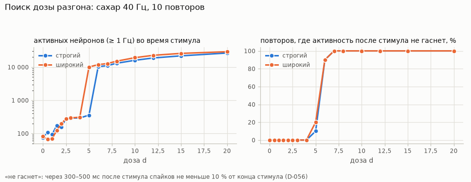
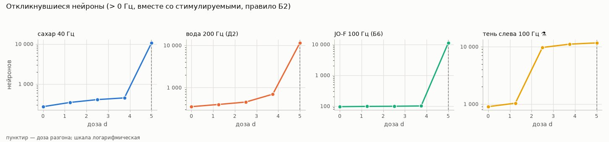
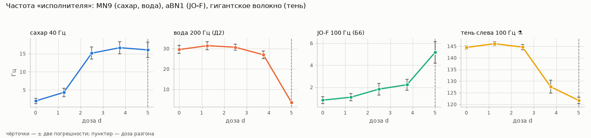
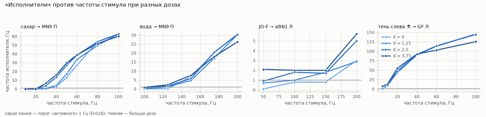
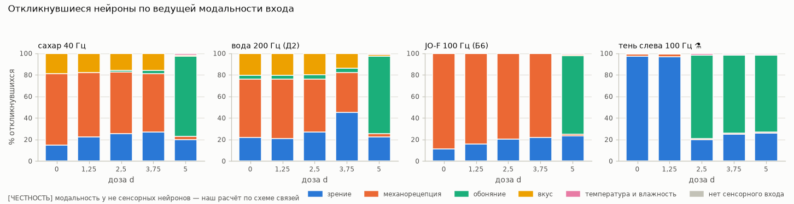
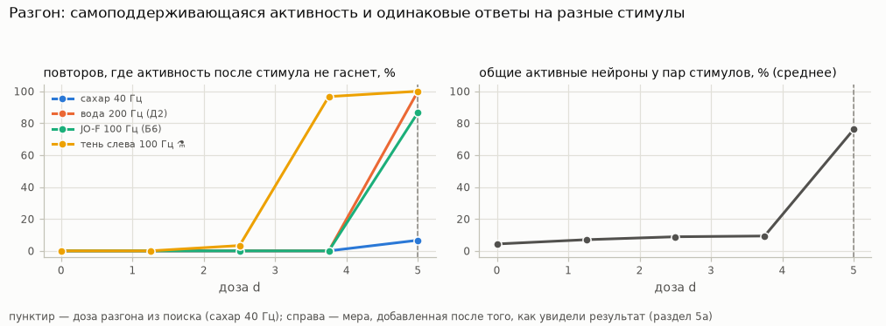
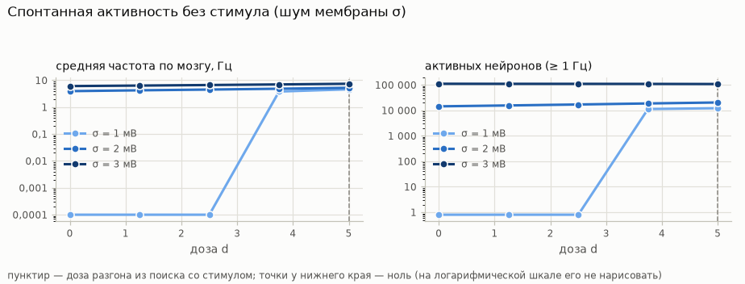

# Эксперимент P1 «психоделик» в режиме «мозг в банке»

*22–23.10.2026, коммит P1. Отдельный эксперимент, его нет в [PLAN_M2.md](PLAN_M2.md). Все таблицы — в [psy/results.md](psy/results.md) (собирает команда `uv run flybrain psy`), решения — D-053…D-056 в [DECISIONS.md](DECISIONS.md). Интерфейс в P1 не менялся: ползунок дозы будет в P2.*

> **[ЧЕСТНОСТЬ] Это вычислительная гипотеза, а не модель того, что «чувствует» муха.** Мы спрашиваем: что произойдёт со схемой мозга мухи, если все нейроны, получающие синапсы от серотониновых нейронов, станут возбудимее — так, как от классического психоделика (агониста рецептора 5-HT2A). О переживаниях, «видениях» или поведении мухи этот опыт ничего не говорит.

## 1. Цель

Модель Shiu et al. (2024) — схема из 138 639 нейронов, в которой каждый нейрон — «копилка» напряжения с порогом. В ней нет нейромодуляторов. Мы добавляем одну управляемую «ручку» — дозу d — и смотрим, как от неё меняется ответ мозга на четыре знакомых стимула (сахар, вода, усик, тень) и что происходит без стимула:

- сколько нейронов откликается и насколько разнообразен узор активности;
- «размываются» ли модальности: начинает ли, например, сахар будить зрительные пути;
- как меняются «исполнители» (MN9, aBN1, гигантское волокно) и их пороги;
- при какой дозе сеть уходит в «разгон» — активность перестаёт затухать сама.

## 2. Честные оговорки (прочитать до результатов)

1. **Тип рецептора у мишени неизвестен** (D-053). У дрозофилы пять рецепторов серотонина: 5-HT1A и 5-HT1B обычно тормозят, 5-HT2A, 5-HT2B и 5-HT7 обычно возбуждают. Коннектом рецепторов не показывает. Мы приняли «все мишени возбуждаются». Это наверняка неверно для части нейронов: например, в грибовидных телах серотонин действует через тормозящий 5-HT1A (Yuan, Joiner, Sehgal, *Curr Biol* 2006). Поэтому эффект в опыте — скорее верхняя оценка.
2. **Серотониновые нейроны выделены неидеально** (D-054): 62 нейрона по строгому критерию против 100–166 в литературе. Часть настоящих серотониновых нейронов, видимо, пропущена.
3. **Число синапсов — замена «плотности рецепторов».** Серотонин действует и вне синапсов (диффузно), этого в модели нет.
4. **Форма эффекта и все числа — наши** (D-055, D-056): снижение порога, ΔV = 1 мВ, s_half = 5, правило разгона, метрики. Данных о том, как агонист 5-HT2A меняет нейроны мухи, у нас нет.
5. **Модель Shiu упрощена** (BRIEF, раздел 8): нет электрических синапсов, обучения, других модуляторов, тела. Стимулы — прямое включение групп сенсорных нейронов, а не настоящий вкус, касание или тень.
6. **Модальность у не сенсорных нейронов — наш расчёт** по схеме связей, а не их «настоящая» функция (D-056).

## 3. Что нашли в данных (шаг 1)

### 3.1. Как хранятся медиаторы

Медиатор в наших данных — **на уровне нейрона**, не синапса. В таблице аннотаций FlyWire 783 два столбца:
- `top_nt` — медиатор, предсказанный нейросетью по снимкам синапсов (Eckstein et al. 2024), с уверенностью `top_nt_conf`; шесть вариантов: ацетилхолин, ГАМК, глутамат, дофамин, серотонин, октопамин;
- `known_nt` — медиатор из литературы со ссылкой `known_nt_source` (есть не у всех нейронов).

Предсказаний для отдельных синапсов в скачанных файлах нет. В файле связей Shiu — только знак отправителя, одинаковый для всех его синапсов.

| предсказанный медиатор | нейронов в модели | медианная уверенность |
|---|---|---|
| ацетилхолин | 86 025 | 0,72 |
| глутамат | 24 858 | 0,60 |
| ГАМК | 19 147 | 0,69 |
| дофамин | 5 905 | 0,64 |
| серотонин | 2 201 | 0,49 |
| октопамин | 210 | 0,42 |

### 3.2. Как движок обращается с серотонином, дофамином и октопамином сейчас

Как с ацетилхолином: **обычный быстрый возбуждающий синапс**, 0,275 мВ на синапс. Знак +1 у 2 127 из 2 201 «серотониновых» нейронов, у 5 897 из 5 905 «дофаминовых», у 192 из 210 «октопаминовых» (остальные — знак −1 или нет выходов). Это логика Shiu — правило «ГАМК и глутамат тормозят, остальные возбуждают» (D-005); знак записан в его файле связей, мы его только читаем (D-025). Медленного модулирующего действия моноаминов в модели нет.

### 3.3. Какие нейроны серотониновые

| критерий | нейронов в модели | от числа в литературе |
|---|---|---|
| по предсказанию (`top_nt` = serotonin) | 2 201 | в 13–22 раза больше |
| широкий: серотонин в `known_nt` с любой ссылкой | 197 (37 типов) | в 1,2–2 раза больше |
| **строгий: окраска антителами или клоны из серотониновых линий** | **62 (27 типов)** | 0,4–0,6 от литературы |

Литература: около 100 серотониновых нейронов во всей нервной системе (обзорная оценка, Alekseyenko et al., *Curr Biol* 2014); 83 на полушарие в мозге с подглоточным ганглием, то есть около 166 (окраска на серотонин и триптофангидроксилазу, Bao et al., *Cell Tissue Res* 2010).

**Предсказание не годится.** Оно называет серотониновыми 2 201 нейрон, из них 1 481 — сенсорные; у 766 из них в литературе ацетилхолин, у 345 — гистамин (фоторецепторы; гистамина нет среди шести медиаторов, которые умеет предсказывать сеть). И наоборот: из 197 нейронов, у которых серотонин указан в литературе, предсказан серотонин только у 18 (у остальных — ацетилхолин 72, глутамат 54, дофамин 48, ГАМК 4, октопамин 1).

**Выбран строгий критерий** (D-054): серотонин в `known_nt` подтверждён окраской антителами против серотонина или одиночными клонами из линий-драйверов серотониновых нейронов. Это 62 нейрона — все парами, по обе стороны мозга: известные CSD, DPM, 5-HTPMPD01, 5-HTPMPV01, 5-HTPMPV03, ExR3 и другие (полный список с подтверждениями — [psy/results.md](psy/results.md), раздел 1.3). Широкий набор больше за счёт трёх типов колончатых нейронов центрального комплекса (FC3, Delta7, hDeltaC — 101 нейрон), где серотонин найден только по РНК в одной работе рядом с быстрым медиатором; он проверен отдельно (раздел 6.7).

**Слабые места строгого критерия:** нейронов меньше, чем в литературе; клоны из линий-драйверов — это сопоставление формы, а не окраска; части `known_nt` и ссылок сопоставлены по порядку (у FB6H это, возможно, ошибка); DNg26 не вошли (способ записан как «unknown»); полнота столбца `known_nt` неизвестна; 12 из 62 нейронов в модели Shiu тормозящие (по предсказанному медиатору), и это не меняем.

### 3.4. Мишени

| | строгий | широкий |
|---|---|---|
| серотониновых нейронов | 62 | 197 |
| их выходных синапсов | 104 243 | 188 629 |
| мишеней (хотя бы 1 синапс) | 21 619 | 27 047 |
| мишеней с 5 и более синапсами | 4 014 | 5 637 |
| медиана синапсов у мишени | 2 | 2 |

Мишени строгого набора — почти все в центральном мозге: 90 % серотониновых синапсов приходят на центральные нейроны (55 % из них — мишени), остальное — на нисходящие, восходящие и зрительные нейроны. Больше всего синапсов получают клетки Кеньона грибовидных тел (KCg-m, KCab), APL, кольцевые нейроны эллипсоидного тела (ER3d), нейроны LAL. **Сами MN9 и гигантские волокна серотониновых синапсов не получают; aBN1 — 2 синапса.** Значит, любой эффект на «исполнителей» — косвенный, через сеть.

## 4. Механизм и параметры (шаг 2)

**Порог нейрона i:** V_th,i = −45 мВ − d · ΔV · h(s_i), h(s) = s / (s + s_half), где s_i — сколько синапсов нейрон получает от серотониновых нейронов (D-055).

| параметр | значение | почему |
|---|---|---|
| ΔV | 1 мВ | единица дозы: доза 1 снижает порог «насыщенного» нейрона на 1 мВ — 1/7 зазора «покой (−52) — порог (−45)» |
| s_half | 5 синапсов | порог «надёжной связи» FlyWire; 1 синапс → h = 1/6, 5 → 1/2, 20 → 0,8, 100 → 0,95 |
| σ (шум) | выключен; 1, 2, 3 мВ — только для опыта без стимула | стандартное отклонение потенциала в покое |

- Веса связей не трогаются: эффект — отдельный массив «на сколько снижен порог» у каждого нейрона.
- **Почему снижение порога, а не усиление входа.** В модели Shiu снизить порог на X — ровно то же самое, что поднять покой и сброс на X: это постоянная деполяризация, которую классически вызывает 5-HT2A. Усиление входа ничего не делает в молчащей сети, одинаково усиливает возбуждение и торможение и по сути правит веса связей (D-055).
- При дозе 1 порог снижен у 21 619 нейронов; на 0,5 мВ и больше — у 4 014 (у них 5 и более серотониновых синапсов). Без шума нейрон сам не выстрелит, пока порог не опустится ниже покоя: для самого «нагруженного» нейрона (1 074 серотониновых синапса) это доза больше 7,03.

### 4.1. Регрессия: при d = 0 — тот же движок, бит в бит

- При d = 0 и σ = 0 движок выполняет **те же операции**, что до P1 (снижение порога и шум включаются только при ненулевых значениях).
- **Тест** `test_zero_dose_is_spike_for_spike_the_engine_before_p1` (`tests/test_engine.py`): отпечаток (SHA-256) всех спайков случайной сети из 400 нейронов, снятый **до** изменения кода, совпадает после — на процессоре и на видеокарте; так же — с явно заданными нулевой дозой и нулевым шумом и после «включить и выключить».
- **На настоящем коннектоме:** сахар 100 Гц, 30 повторов, то же зерно — счётчики спайков всех нейронов во всех повторах совпали с сохранёнными результатами проверки C6.
- **Полный повторный прогон проверки** `flybrain validate --rerun` (26,8 мин): [VALIDATION.md](VALIDATION.md) совпал с прежним во всех числах и отметках (А — 15 из 15; Б1, Б2, Б3, Б5, Б7, Д1, Д2 — да; Б4 — нет; Б6 — у эталона на границе), картинки — байт в байт. Изменились только номер версии кода движка и строка о времени расчёта (45–50 с вместо 45–49 с).

### 4.2. Скорость

Замер поочерёдно старым и новым кодом в одном процессе (видеокарта RTX 5070 Laptop):

| режим | до P1 | после P1, d = 0 | после P1, доза включена | после P1, шум включён |
|---|---|---|---|---|
| 30 повторов по 1 с | 45,3 и 45,3 с | 45,5 и 45,2 с | 46,7 и 45,3 с | — |
| 1 повтор («живой» режим), 3 с жизни мухи | 6,3–7,3 с | 6,3–7,3 с | 6,3–7,3 с | 6,5–7,6 с |

При d = 0 скорость не изменилась (разница в пределах разброса замеров; видеокарта ноутбука от нагрева замедляется на 10–15 % за серию). С включённой дозой — на 1–2 % медленнее, с шумом — примерно на 4 %.

## 5. Опыт: как устроен (шаг 3)

Правила записаны до расчётов (D-056).

- **Стимулы** — те же, что в проверке C6: сахар 40 Гц («исполнитель» — MN9 из статьи), вода 200 Гц (пункт Д2, MN9 из статьи), JO-F 100 Гц (пункт Б6, aBN1 из статьи), тень слева 100 Гц (пункт В, левое гигантское волокно).
- **Протокол:** 30 повторов; 1 с со стимулом, затем 0,5 с без стимула. Метрики — за 1 с стимула.
- **Разгон:** через 300–500 мс после выключения стимула спайков не меньше 10 % от последних 200 мс стимула. Без шума модель Shiu после стимула затихает, поэтому поздняя активность может быть только самоподдерживающейся.
- **Дозы:** сначала поиск дозы разгона на сахаре 40 Гц (10 повторов, дозы от 0 до 20). Нашлась доза **d\* = 5**. По заранее записанному правилу дозы основного опыта — 0; 1,25; 2,5; 3,75 (четверть, половина и три четверти от d\*); доза 5 посчитана отдельно.
- **Метрики:** число откликнувшихся (правило Б2: больше 0 Гц за все повторы, вместе со стимулируемыми); эффективное число нейронов exp(H) — насколько равномерно активность размазана по нейронам; ведущая модальность входа у откликнувшихся; частоты и пороги «исполнителей»; признаки разгона.
- **Ещё три части:** пороги «исполнителей» по частоте стимула (10 повторов на точку); без стимула с шумом мембраны σ = 1, 2, 3 мВ (10 повторов); весь основной опыт заново с широким критерием серотониновых нейронов.
- Всего 171 расчёт, около 1¼ часа на видеокарте.

## 6. Результаты

Полные таблицы — [psy/results.md](psy/results.md). Числа ниже — по строгому критерию; «±» — погрешность среднего по 30 повторам.

### 6.1. Доза разгона



| доза | 0 | 1 | 2 | 3 | 4 | **5** | 6 | 7–20 |
|---|---|---|---|---|---|---|---|---|
| активных нейронов (≥ 1 Гц) во время стимула | 75 | 94 | 157 | 292 | 293 | 357 | 10 341 | 11 103–26 682 |
| повторов, где активность после стимула не гаснет | 0 из 10 | 0 | 0 | 0 | 0 | **1 из 10** | 9 из 10 | 10 из 10 |

- **Переход резкий и случайный.** До дозы 4 включительно через 300 мс после стимула во всех повторах полная тишина. При дозе 5 в одном повторе из десяти сеть «зажглась» и после стимула не погасла; при 6 — в девяти; от 7 — во всех. Широкий критерий даёт ту же дозу разгона, 5 (2 повтора из 10).
- **«Неограниченного роста» нет — есть второе состояние.** «Зажжённая» сеть не разгоняется до бесконечности: она переходит в устойчивое состояние, где около 11 тысяч нейронов стреляют в среднем примерно по 60 Гц (около 650 тысяч спайков в секунду на весь мозг против 1–20 тысяч в обычном ответе). Это состояние держится само, без стимула.
- **Кто в нём:** в основном клетки Кеньона грибовидных тел (около 3 600 из 5 177), ещё 3 300–3 700 центральных нейронов без класса в таблице, обонятельная система — проекционные и локальные нейроны усиковой доли, обонятельные рецепторные нейроны, локальные нейроны латерального рога — и центральный комплекс.

### 6.2. Ниже разгона: ответ на стимулы





| стимул | метрика | d = 0 | 1,25 | 2,5 | 3,75 | 5 🔥 |
|---|---|---|---|---|---|---|
| сахар 40 Гц | откликнулось (Б2) | 271 | 346 | 407 | 449 | 10 640 |
| | эффективное число нейронов | 54 | 86 | 189 | 200 | 5 557 |
| | MN9 (правый), Гц | 2,0 ± 0,4 | 4,3 ± 0,6 | 15,1 ± 0,8 | 16,6 ± 0,8 | 16,0 ± 1,1 |
| | повторов «не гаснет» | 0 из 30 | 0 | 0 | 0 | 2 |
| вода 200 Гц | откликнулось | 353 | 398 | 453 | 697 | 11 426 |
| | эффективное число | 114 | 135 | 161 | 195 | 7 361 |
| | MN9 (правый), Гц | 29,5 ± 1,0 | 31,4 ± 1,0 | 30,7 ± 0,7 | 27,0 ± 0,9 | 3,6 ± 0,3 |
| | повторов «не гаснет» | 0 | 0 | 0 | 0 | 30 |
| JO-F 100 Гц | откликнулось | 96 | 98 | 99 | 101 | 11 139 |
| | эффективное число | 16 | 16 | 17 | 17 | 7 259 |
| | aBN1 (левый), Гц | 0,83 ± 0,16 | 1,1 ± 0,2 | 1,8 ± 0,3 | 2,2 ± 0,2 | 5,2 ± 0,5 |
| | повторов «не гаснет» | 0 | 0 | 0 | 0 | 26 |
| тень слева 100 Гц ⚗ | откликнулось | 900 | 1 034 | 9 687 | 11 062 | 11 633 |
| | эффективное число | 315 | 345 | 1 638 | 7 156 | 7 426 |
| | гигантское волокно (левое), Гц | 144,5 ± 0,4 | 146,1 ± 0,5 | 144,6 ± 0,6 | 127,6 ± 1,4 | 121,7 ± 0,7 |
| | повторов «не гаснет» | 0 | 0 | **1** | **29** | 30 |

- **Пока сеть не «зажглась», эффект плавный.** С дозой откликается больше нейронов: у сахара — в 1,7 раза, у воды — в 2 раза, у JO-F — на 5 %. Активность размазывается по большему числу нейронов: эффективное число у сахара растёт в 3,7 раза.
- **Сильнее всего меняется слабый ответ.** MN9 на сахар 40 Гц вырастает в 8 раз (с 2,0 до 16,6 Гц), хотя у самого MN9 серотониновых синапсов нет. Усиление распределённое: из 285 нейронов, получающих вход прямо от сахарных, серотониновые синапсы есть у 87 (5 и больше — у 21); у нейронов цепи кормления из статьи их почти нет. Через какие именно нейроны идёт усиление, мы не разбирали. Сильный ответ — MN9 на воду 200 Гц, гигантское волокно на тень — почти не меняется: он и так близок к насыщению.
- **Тень «зажигает» сеть раньше остальных:** при дозе 2,5 — в одном повторе из 30, при 3,75 — в 29. То есть доза разгона зависит от стимула, а не только от сети: 162 зрительных нейрона на 100 Гц толкают мозг сильнее, чем 20 сахарных на 40 Гц. Доза 5, найденная на сахаре, для воды, JO-F и тени уже далеко за порогом.
- **Осторожно со средними при дозе 5 у сахара и при 2,5 у тени.** Они смешивают два состояния: 2 «зажжённых» повтора из 30 у сахара и 1 у тени дают тысячи нейронов «больше 0 Гц» по правилу Б2, хотя остальные повторы выглядят как обычный ответ.

### 6.3. Пороги «исполнителей»



Порог — наименьшая частота стимула, при которой «исполнитель» активен (≥ 1 Гц); 10 повторов на точку, линейно между точками сетки.

| стимул → исполнитель | d = 0 | 1,25 | 2,5 | 3,75 |
|---|---|---|---|---|
| сахар → MN9 (правый) | 34 Гц | 31 Гц | 23 Гц | 22 Гц |
| вода → MN9 (правый) | 128 Гц | 120 Гц | 108 Гц | 102 Гц |
| JO-F → aBN1 (левый) | 155 Гц | 100 Гц | 56 Гц | ≤ 50 Гц |
| тень → гигантское волокно (левое) | 6 Гц | ≤ 5 Гц | ≤ 5 Гц | ≤ 5 Гц |

- Все пороги снижаются с дозой: у сахара — на треть, у воды — на пятую часть, у JO-F → aBN1 — больше чем втрое. У тени порог и так ниже сетки: при 5 Гц волокно с дозой разгоняется с 0,1 до 7,8 Гц.
- **Следствие для проверок статьи (для сведения).** Вывод Б6 «JO-F почти не включает aBN1» держится только без дозы: при дозе 1,25 aBN1 от JO-F 100 Гц — 1,1 ± 0,2 Гц (на границе по правилу D-031), при 2,5 — 1,8 ± 0,3 Гц, уже уверенно выше порога «активного». Вывод Б4 «вода 100 Гц включает MN9» не выполняется и с дозой: при 3,75 MN9 от воды 100 Гц — 0,9 Гц.

### 6.4. «Размываются» ли модальности



- **Ниже разгона — слабо.** У ответа на сахар доля входа от вкуса (взвешенная по спайкам) падает с 47 до 31 %, от механорецепторов растёт с 29 до 40 %: включаются соседние нейроны подглоточной области, где много входов от механорецепторов хоботка. В зрительной системе на сахар откликается не больше 4 нейронов (0 без дозы), на воду — 37 при дозе 3,75 (2 без дозы). Энтропия модальностей у сахара — с 1,25 до 1,57 бита, у JO-F — с 0,50 до 0,76, у воды и тени почти не меняется.
- **Значит, сахар зрительные пути почти не будит, пока сеть не «зажглась».** Механосенсорные — будит больше, но это соседи по той же подглоточной области.
- **В «зажжённом» состоянии модальность стимула пропадает.** У всех четырёх стимулов 57–69 % входа откликнувшихся — от обоняния (усиковая доля и грибовидные тела), «чужих» модальностей — 74–99 % откликнувшихся.

### 6.5. При разгоне все стимулы дают одно и то же



**[ЧЕСТНОСТЬ]** Сходство ответов разных стимулов — мера, добавленная после того, как увидели результат; в D-056 её не было, порога у неё нет.

| доза | 0 | 1,25 | 2,5 | 3,75 | 5 |
|---|---|---|---|---|---|
| общие активные нейроны: сахар — вода | 25 % | 40 % | 51 % | 54 % | 62 % |
| общие активные нейроны: остальные пары стимулов | 0–1 % | 0–1 % | 0–1 % | 0–1 % | 59–94 % |

- Ниже разгона ответы на разные стимулы почти не пересекаются (сахар и вода — оба вкус, у них общая часть растёт с дозой).
- При дозе 5 вода, JO-F и тень (все «зажглись») делят 89–94 % активных нейронов: какой стимул ни подай, мозг приходит в одно и то же состояние.
- **В этом состоянии включаются «чужие» исполнители, а свои слабеют.** Левый MN9 стреляет 8,8 Гц от касания усика (JO-F) и 10,6 Гц от тени (без дозы — 0). MN9 на воду падает с 29,5 до 3,6 Гц; правое гигантское волокно на тень — со 101 до 46,5 Гц.

### 6.6. Без стимула: шум мембраны



| σ | d = 0 | 1,25 | 2,5 | 3,75 | 5 |
|---|---|---|---|---|---|
| 1 мВ: активных нейронов | 0 | 0 | 0 (7 нейронов выстрелили хоть раз) | 11 318 | 12 158 |
| 2 мВ: активных нейронов | 14 392 | 15 607 | 17 024 | 18 702 | 20 418 |
| 3 мВ: активных нейронов | 110 771 | 110 140 | 109 881 | 109 401 | 108 237 |

- **При слабом шуме (σ = 1 мВ)** мозг без стимула молчит до дозы 2,5, а при 3,75 **«зажигается» сам**, без всякого стимула. Состав — то же состояние: около 3 800 клеток Кеньона по ~36 Гц и обонятельная система.
- **Важный контроль:** при шуме σ = 2 мВ то же состояние (около 3 900 клеток Кеньона по ~35 Гц) возникает **и без дозы**. Значит, «зажжённое» состояние — свойство самой схемы в модели Shiu, доза только облегчает переход в него. При σ = 3 мВ шумит почти весь мозг (110 тысяч активных нейронов, больше всего в зрительных долях), и доза ничего не меняет.
- σ = 2 и 3 мВ оказались слишком сильным шумом для этой модели: весь мозг активен уже без дозы. Значения σ были выбраны заранее и не подгонялись.

### 6.7. Проверка устойчивости: широкий критерий

С широким набором серотониновых нейронов (197 вместо 62) числа почти те же: та же доза разгона (5), то же «зажигание» тени при 3,75 (28 повторов из 30 против 29), MN9 на сахар при 3,75 — 19,2 против 16,6 Гц, пороги и доли модальностей — в пределах случайности. Единственное заметное различие — тень при дозе 2,5: по строгому критерию один повтор из 30 «зажёгся» (отсюда 9 687 откликнувшихся), по широкому — ни одного (1 167). Выводы от выбора критерия не зависят.

## 7. Выводы

1. **Пока сеть не «зажглась», «психоделик» в этой модели — плавное усиление.** Откликается больше нейронов, активность размазана шире, пороги «исполнителей» ниже (сахар → MN9 — на треть, JO-F → aBN1 — втрое), слабые ответы усиливаются в разы. Ответы остаются своими: модальности размываются слабо, сахар почти не будит зрительную систему.
2. **Дальше — резкий и случайный переход во второе состояние**, которое держится само: 10–11 тысяч нейронов, ядро — клетки Кеньона грибовидных тел и обонятельная система. Доза, при которой это случается, зависит от стимула: тень — 3,75, вода и JO-F — 5, сахар 40 Гц — 5–6. Без стимула при слабом шуме — 3,75.
3. **В этом состоянии стимулы становятся неразличимы** (до 94 % общих активных нейронов), включаются «чужие» исполнители (MN9 от касания усика и от тени), а свои слабеют. Это и есть самое сильное «размывание модальностей» в опыте — но это не постепенное смешение, а падение в одно и то же состояние.
4. **Это состояние есть в схеме и без дозы:** его включает один шум мембраны (σ = 2 мВ). Доза его не создаёт, а снижает барьер перед ним.
5. **Выводы устойчивы к выбору серотониновых нейронов** (строгий и широкий критерии дают одно и то же).

## 8. Что из этого НЕ следует

- **Не следует, что муха под психоделиком что-то «видит» или «чувствует».** Модель не знает, что такое ощущение; мы смотрим только на спайки.
- **Не следует, что психоделик вызывает у мухи судороги или «замыкание» грибовидных тел.** «Зажжённое» состояние держится на клетках Кеньона, а там серотонин в живой мухе действует через тормозящий рецептор 5-HT1A (Yuan, Joiner, Sehgal 2006) — то есть, скорее всего, против нашего допущения. Кроме того, это состояние есть в модели и без дозы (при шуме), а в модели нет электрических синапсов, медленного торможения, адаптации и других механизмов, которые в живом мозге гасят такую активность.
- **Числа доз ничего не значат в миллиграммах.** «Доза 5» — это 5 мВ снижения порога у самых нагруженных нейронов; связь с концентрацией вещества мы не знаем (ΔV — наш выбор, D-055).
- **MN9 при больших дозах — не «муха вытягивает хоботок».** Тела нет; это частота одного мотонейрона.
- **Рост разнообразия (exp(H)) — не подтверждение гипотезы «энтропийного мозга» у людей.** Другая мера, другая система, другое устройство модели.
- **Пороги и частоты зависят от условий стимула:** прямое включение 162 зрительных нейронов на 100 Гц — гораздо сильнее, чем настоящая тень; поэтому и «раннее зажигание» тени — свойство нашего стимула, а не мухи.
- **Ниже разгона эффект — верхняя оценка:** мы приняли, что все мишени серотонина возбуждаются (D-053).

## 9. Как повторить

Нужны данные из M1 (`fetch-data`, `build-data`). Весь опыт — одна команда; готовые расчёты сохраняются в `data/psy/` и при повторе берутся оттуда, так что второй запуск занимает секунды:

```bash
uv run flybrain psy
```

Только поиск дозы разгона (около 11 минут):

```bash
uv run flybrain psy --only runaway
```

Пересчитать всё заново (около 1¼ часа на видеокарте):

```bash
uv run flybrain psy --rerun
```

Настройки — `config/psy.yaml`, код — `flybrain/serotonin.py`, `flybrain/modality.py`, `flybrain/psy.py`, `flybrain/psyreport.py`; добавки в движке — `Engine.set_threshold_shift` и `Engine.set_noise` в `flybrain/engine/core.py`.
