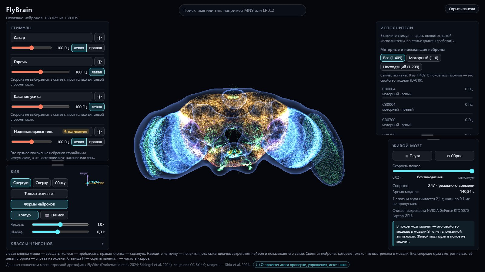
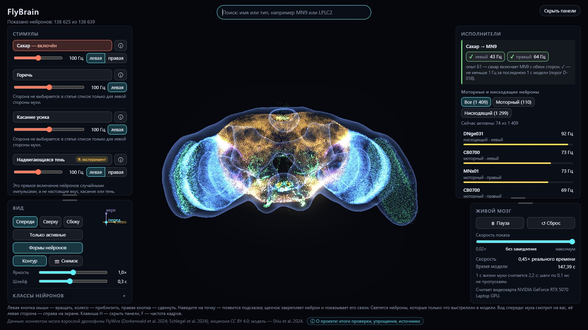
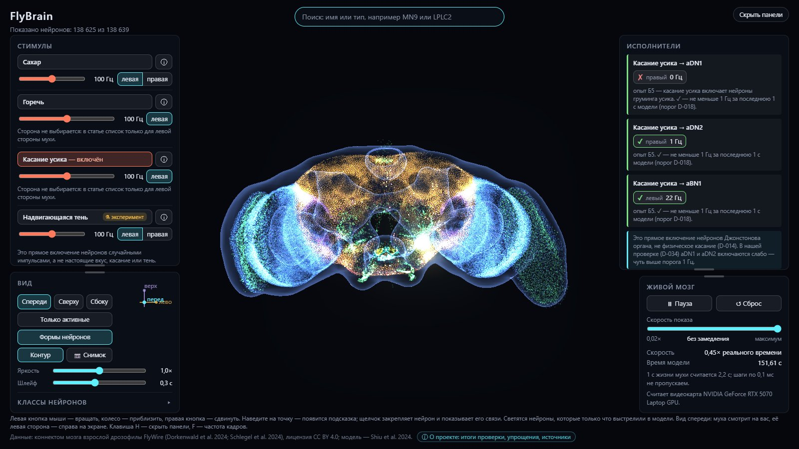
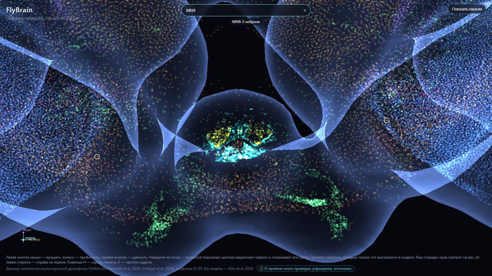
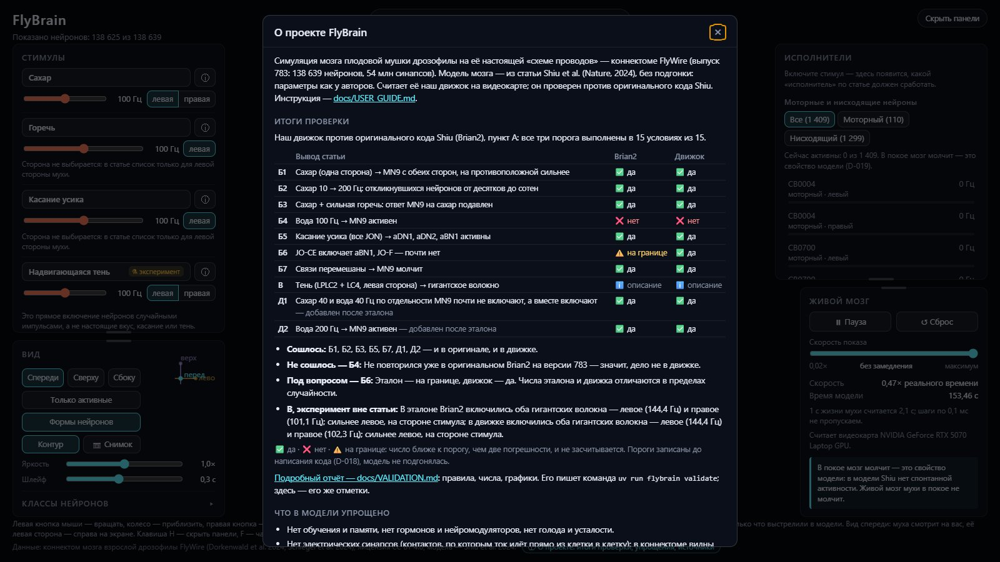

# Как пользоваться FlyBrain

FlyBrain показывает в 3D мозг плодовой мушки дрозофилы: все 138 639 нейронов из коннектома FlyWire, каждый — точка на своём настоящем месте. Вы включаете стимул, например «сахар», и видите, как по мозгу бежит активность и какие нейроны-«исполнители» включаются в конце. Мозг считает модель из статьи Shiu et al. (Nature, 2024); как она проверена — в [VALIDATION.md](VALIDATION.md).

## 1. Первый запуск (один раз)

Нужен менеджер `uv` — как его поставить, написано в [SETUP.md](SETUP.md), раздел 3. Затем откройте PowerShell и выполните команды по одной:

```
cd C:\Projects\FlyBrain
uv sync
uv run flybrain doctor
uv run flybrain fetch-data
uv run flybrain build-data
```

- `uv sync` ставит Python и библиотеки (несколько минут в первый раз).
- `doctor` проверяет машину: все строки должны быть зелёными «OK».
- `fetch-data` скачивает данные (около 140 МБ) и сверяет их контрольные суммы.
- `build-data` готовит данные для программы (около 10 секунд).

**Необязательно:**
- `uv run flybrain fetch-skeletons` — формы нейронов (5,4 ГБ). Без них всё работает, только переключатель «Формы нейронов» будет недоступен.
- `uv run flybrain reference`, затем `uv run flybrain validate` — заново провести проверку модели (около 25 минут и ещё 40–50 минут). Готовые итоги уже лежат в проекте.

## 2. Запуск

Дважды щёлкните `run.bat` в папке `C:\Projects\FlyBrain`. Откроется чёрное окно сервера, а через несколько секунд — браузер с мозгом. Чтобы остановить программу, закройте чёрное окно.

То же из PowerShell:

```
cd C:\Projects\FlyBrain
uv run flybrain serve
```

## 3. Что на экране



- **В середине** — облако нейронов. Цвет точки — класс нейрона (таблица ниже). Полупрозрачная оболочка — контур мозга: это оформление по плотности точек, а не анатомия.
- **Сверху посередине** — поиск по имени или типу нейрона.
- **Слева сверху — «Стимулы»**: кнопки «Сахар», «Горечь», «Касание усика», «Надвигающаяся тень ⚗».
- **Слева снизу — «Вид»**: кнопка «Вид по умолчанию», «Только активные», «Формы нейронов», «Контур», ползунки яркости «Активные» (вспышки) и «Неактивные» (тусклое облако и контур), «Шлейф» и список цветов.
- **Справа сверху — «Исполнители»**: моторные и нисходящие нейроны (те, что передают команды из мозга в тело), самые активные — наверху. Блок «ожидается по статье» отмечает галочкой то, что должно включиться по статье.
- **Справа снизу — «Живой мозг»**: пауза, сброс, скорость показа, время модели.
- **Внизу** — компас и кнопки **«⌨ Управление»** (окно со всеми действиями мышью и клавишами) и **«ⓘ О проекте»**.

Панели можно двигать и менять их размер, как окна Windows. Наведите курсор на самую границу панели — он станет стрелками: тяните, чтобы изменить размер (за любую сторону или угол). Чуть внутрь от границы, до содержимого, — узкая рамка: курсор станет крестиком, тяните, чтобы передвинуть панель. Двигать можно и за название (например, «СТИМУЛЫ»). Двойной щелчок в рамке или по названию возвращает панель на обычное место, на границе — обычный размер. Кнопка «−» в правом верхнем углу сворачивает панель до названия, «+» разворачивает обратно. После перезапуска программы (или F5) все панели снова стоят на обычных местах и в обычном размере.

**Мышь и клавиши.**

| Действие | Что делать |
|---|---|
| вращать мозг | левая кнопка мыши |
| приблизить, отдалить | колесо мыши |
| сдвинуть | правая кнопка мыши |
| узнать, что за нейрон | навести мышь на точку |
| закрепить нейрон и увидеть его связи | щёлкнуть по точке; снять — Esc или «×» на карточке |
| передвинуть, свернуть панель или карточку нейрона, изменить размер | двигать — тянуть за рамку у края или за название; размер — тянуть за саму границу; кнопка «−»; двойной щелчок в рамке — как было |
| вернуть камеру в вид по умолчанию | кнопка «↺ Вид по умолчанию» в панели «Вид» или клавиша R |
| скрыть или показать панели | клавиша H |
| частота кадров | клавиша F |

**Стороны.** «Левая» и «правая» везде — со стороны самой мухи. На виде спереди муха смотрит на вас, поэтому её левая сторона — справа на экране. Компас внизу посередине экрана показывает, где у мухи перед, лево и верх.

## 4. Что значат цвета

| Цвет | Класс нейронов |
|---|---|
| синий | зрительная доля |
| оранжевый | центральный мозг |
| зелёный | чувствительный (сенсорный) |
| фиолетовый | зрительный проекционный (из зрительной доли в центральный мозг) |
| розовый | зрительный центробежный (из центрального мозга в зрительную долю) |
| бирюзовый | восходящий (из тела в мозг) |
| салатовый | чувствительный восходящий (из тела в мозг) |
| красный | нисходящий (из мозга в тело) |
| жёлтый | моторный |
| белый | эндокринный (выделяет гормоны) |

Точные оттенки и число нейронов каждого класса — в списке «Классы нейронов» в панели «Вид».

**Вспышка** — нейрон только что выстрелил (дал спайк) в модели; она гаснет за время «шлейфа». **Кольца:** белое — нейрон под мышкой, голубое — закреплённый нейрон, жёлтые — найденные поиском, синие и оранжевые — его входы и выходы (по 20 самых сильных; к ним же идут тонкие линии).

В покое мозг тёмный: в модели нет спонтанной активности. Это свойство модели, а не ошибка.

## 5. Попробуйте

### Сахар → мотонейрон хоботка MN9

Нажмите «Сахар». Внизу центральной части мозга загорается кучка вкусовых нейронов, через доли секунды — соседние, затем MN9 (он заставляет муху вытянуть хоботок к еде). В панели «Исполнители» MN9 поднимается наверх, в блоке «ожидается по статье» у него галочка.



Нажмите «Сахар» ещё раз — стимул выключится, и полоски в панели «Исполнители» примерно за полсекунды упадут до нуля.

### Сахар + горечь

Включите «Сахар», затем «Горечь» и сдвиньте её ползунок на 200 Гц. MN9 гаснет или сильно слабеет: горечь подавляет ответ на сахар (пункт Б3 проверки).

### Касание усика

Нажмите «Касание усика». Включаются нейроны груминга усика: aBN1 — сильно (около 24 Гц), aDN1 и aDN2 — слабо (около 3 Гц), но тоже выше порога «активного» нейрона в 1 Гц (пункт Б5 проверки).

**Сторона мухи.** У «Сахара» и «Тени» можно выбрать левую или правую сторону. У «Горечи» и «Касания усика» — только левую: в статье списки нейронов только для неё. Правых «двойников» мы искали по таблице аннотаций FlyWire и проверили, но проверку они не прошли: у усика однозначных двойников нет вовсе, а правые двойники горечи почти не подавляют ответ на сахар (D-047, раздел Е отчёта о проверке). Почему именно — написано в «ⓘ» у кнопки.



### Надвигающаяся тень ⚗

Это **наш эксперимент**, в статье его нет: мы напрямую включаем зрительные нейроны LPLC2 и LC4 одной стороны и смотрим на гигантское волокно (GF, нейрон побега). В модели оба волокна включаются, сильнее — на стороне «тени». Насколько это похоже на живую муху, этот опыт не говорит.

**Важно про все стимулы.** Кнопка не создаёт настоящий вкус, касание или тень. Она заставляет выбранную группу сенсорных нейронов стрелять случайными импульсами с заданной частотой — как в статье Shiu. Кнопка «ⓘ» рядом со стимулом показывает, какие именно нейроны включаются и откуда взят список.

## 6. Поиск и один нейрон

Наберите в поиске `MN9` и нажмите Enter: камера подлетает к двум найденным нейронам (левому и правому), они обведены маленькими жёлтыми кольцами. Камера отходит настолько, чтобы все найденные нейроны поместились в середину экрана между панелями. Можно искать по русскому имени («гигантское волокно») или по типу FlyWire (`LPLC2`, `DNp01`).



Наведите мышь на точку — появится подсказка: имя, класс, сторона, медиатор и знак в модели («возбуждает» или «тормозит»), номер FlyWire и текущая частота. Щёлкните — нейрон закрепится: справа появится карточка с его самыми сильными входами и выходами, а в облаке — линии к ним. Щелчок по имени в карточке переводит к этому соседу. Карточку можно утащить за заголовок или рамку у края в любое место, свернуть кнопкой «−» (останется только имя нейрона) и растянуть за границу. Двойной щелчок по заголовку возвращает карточку на обычное место; после перезапуска она и так стоит там.

## 7. «О проекте» и итоги проверки

Кнопка **«ⓘ О проекте»** внизу экрана открывает окно: что получилось при проверке модели (что сошлось с оригинальным кодом и статьёй, а что нет), что в модели упрощено, чьи данные используются (лицензия CC BY 4.0) и ссылки на статьи. Ссылка «Подробный отчёт» открывает [VALIDATION.md](VALIDATION.md) прямо в браузере.



## 8. Если что-то не так

| Что видите | Что делать |
|---|---|
| в чёрном окне «нет подготовленных данных» | выполнить `uv run flybrain fetch-data`, затем `uv run flybrain build-data` |
| «порт 8765 занят другой программой» | `uv run flybrain serve --port 8766` и открыть в браузере `http://127.0.0.1:8766/` |
| скорость в панели «Живой мозг» намного меньше 0,3× | проверить `uv run flybrain doctor`: видна ли видеокарта |
| в окне «О проекте» «Итоги проверки не загрузились» | выполнить `uv run flybrain validate` |
| переключатель «Формы нейронов» серый | формы не скачаны: `uv run flybrain fetch-skeletons` (5,4 ГБ, необязательно) |
| в браузере старая версия страницы | закрыть чёрное окно и снова запустить `run.bat`: устаревший сервер заменяется сам |
