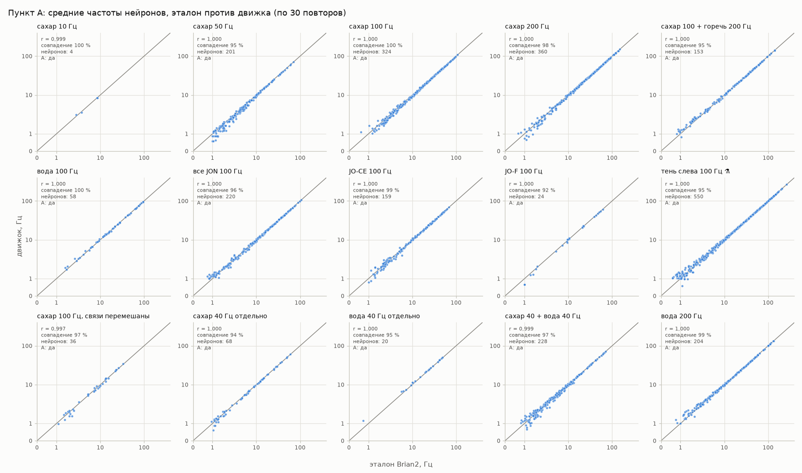
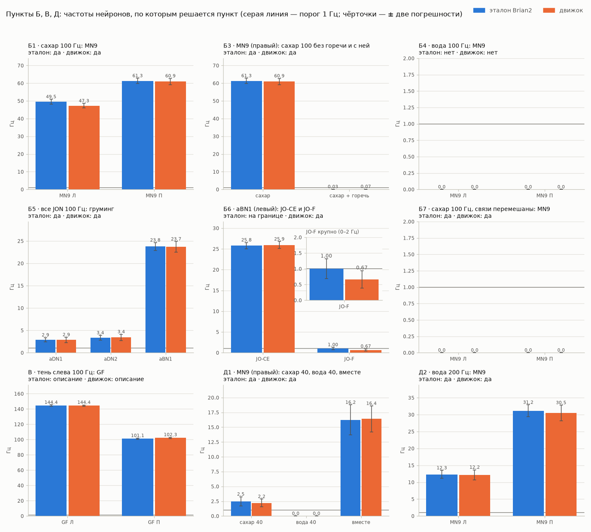
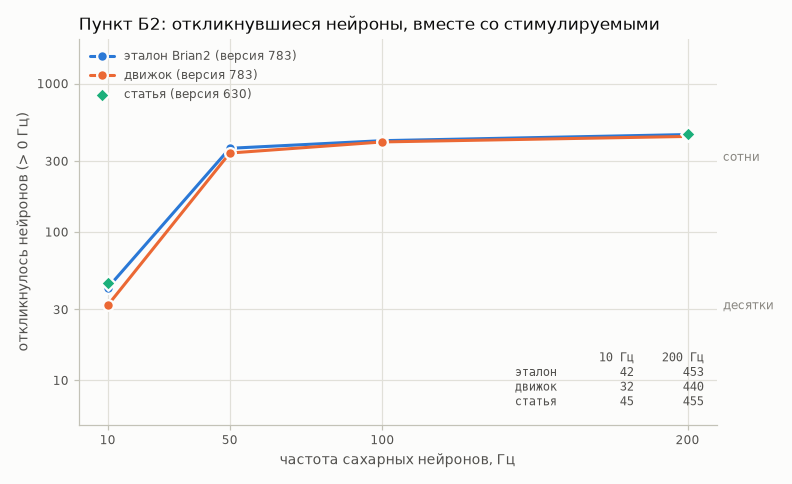
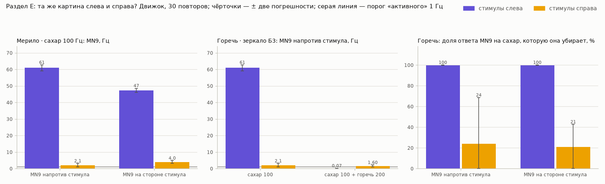

# Проверка движка FlyBrain (главный критерий M1)

*Отчёт собирает команда `uv run flybrain validate`. Файл каждый раз пишется заново — вручную его не правят. Правила проверки — [D-031 и D-032](DECISIONS.md), пороги А — [D-018](DECISIONS.md).*

**Что сравниваем.**
- **Эталон** — оригинальный код Shiu et al. (Brian2) на коннектоме FlyWire 783, по 30 повторов на условие (коммит C4).
- **Движок** — наш расчёт той же модели на видеокарте (коммит C5), тоже по 30 повторов, со своими случайными числами. Поэтому спайк в спайк расчёты не совпадают и не должны; сравниваем средние.
- **Статья** — Shiu et al., *Nature* 2024 (препринт bioRxiv 10.1101/2023.05.02.539144). Её числа посчитаны на старой версии коннектома 630, поэтому с ней сравниваем только качественно.
- Модель не подгоняли: параметры — D-005, пороги — D-018.

## Итог

| Пункт | Что проверяем | Эталон Brian2 | Движок |
|---|---|---|---|
| А | движок совпадает с эталоном (все условия) | — | ✅ да: 15 из 15 |
| Б1 | Сахар (одна сторона) → MN9 с обеих сторон, на противоположной сильнее | ✅ да | ✅ да |
| Б2 | Сахар 10 → 200 Гц: откликнувшихся нейронов от десятков до сотен | ✅ да | ✅ да |
| Б3 | Сахар + сильная горечь: ответ MN9 на сахар подавлен | ✅ да | ✅ да |
| Б4 | Вода 100 Гц → MN9 активен | ❌ нет | ❌ нет |
| Б5 | Касание усика (все JON) → aDN1, aDN2, aBN1 активны | ✅ да | ✅ да |
| Б6 | JO-CE включает aBN1, JO-F — почти нет | ⚠️ на границе | ✅ да |
| Б7 | Связи перемешаны → MN9 молчит | ✅ да | ✅ да |
| В | Тень (LPLC2 + LC4, левая сторона) → гигантское волокно | ℹ️ описание | ℹ️ описание |
| Д1 | Сахар 40 и вода 40 Гц по отдельности MN9 почти не включают, а вместе включают | ✅ да | ✅ да |
| Д2 | Вода 200 Гц → MN9 активен | ✅ да | ✅ да |
| Е | Правая сторона для горечи и усика (D-047): кнопка | — | горечь — ❌ не включена; касание усика — ❌ не включена |

Отметки: ✅ да · ❌ нет · ⚠️ на границе — число ближе к порогу, чем две погрешности, по 30 повторам нельзя сказать уверенно; **не считается выполненным** · ℹ️ описание — порога нет.

**Главное простыми словами.**

- **Движок против эталона (А):** все три порога выполнены в 15 условиях из 15.
- **Б1, Б2, Б3, Б5, Б7, Д1, Д2:** повторились и в эталоне Brian2, и в движке.
- **Б4:** не повторился уже в оригинальном Brian2 на версии 783 — значит, дело не в движке.
- **Б6:** эталон — на границе, движок — да. Эталон: aBN1 из статьи (левый): JO-CE — 25,8 ± 0,4 Гц, JO-F — 1,0 ± 0,2 Гц, в 26 раз меньше; движок: aBN1 из статьи (левый): JO-CE — 25,9 ± 0,4 Гц, JO-F — 0,67 ± 0,14 Гц, в 39 раз меньше. Числа эталона и движка отличаются в пределах случайности.
- **В (тень):** В эталоне Brian2 включились оба гигантских волокна — левое (144,4 Гц) и правое (101,1 Гц); сильнее левое, на стороне стимула; в движке включились оба гигантских волокна — левое (144,4 Гц) и правое (102,3 Гц); сильнее левое, на стороне стимула.
- **Е, горечь справа:** двойников 8 (для 8 из 20 нейронов левого списка); кнопка «правая сторона» не включена: вывод опыта слева — «да», справа — «на границе», а нужно «да» с обеих сторон.
- **Е, касание усика справа:** двойников 0 (для 0 из 145 нейронов левого списка); кнопка «правая сторона» не включена: правых двойников по правилу нет ни у одного типа клеток.

**Как читать числа.** Частота — среднее за 30 повторов по 1 с. «± X» — погрешность этого среднего (насколько оно могло бы сдвинуться при других случайных импульсах стимула). «Активный нейрон» — не меньше 1 Гц, то есть в среднем хотя бы один спайк за секунду (D-018). Стороны «левый/правый» — со стороны самой мухи (D-011).

## А. Движок против эталона

Для каждого условия три порога D-018: **А1** — корреляция средних частот не меньше 0,95 (считается по нейронам, активным хотя бы в одном расчёте); **А2** — совпадение наборов активных нейронов не меньше 80 %: общие активные, делённые на активных хотя бы в одном расчёте; **А3** — 10 ключевых нейронов (MN9, aDN1, aDN2, aBN1, GF с обеих сторон) отличаются не больше чем на 15 % или 3 Гц. Стимулируемые нейроны в А1 и А2 не считаются: их включаем мы сами.

| Условие | А1 корреляция частот (≥ 0,95) | А2 совпадение активных (≥ 80 %) | А3 ключевые нейроны (±15 % или ±3 Гц) | Итог | Шумовой предел: корреляция / совпадение |
|---|---|---|---|---|---|
| сахар 10 Гц | ✅ 0,999 | ✅ 100 % (4 из 4; эталон 4, движок 4) | ✅ все 10 молчат в обоих расчётах | ✅ да | 0,998 / 100 % |
| сахар 50 Гц | ✅ 1,000 | ✅ 95 % (190 из 201; эталон 201, движок 190) | ✅ ближе всех к допуску MN9 П: 12,4 → 13,0 Гц (допуск ±3,0) | ✅ да | 1,000 / 95 % |
| сахар 100 Гц | ✅ 1,000 | ✅ 100 % (323 из 324; эталон 323, движок 324) | ✅ ближе всех к допуску MN9 Л: 49,5 → 47,3 Гц (допуск ±7,4) | ✅ да | 1,000 / 99 % |
| сахар 200 Гц | ✅ 1,000 | ✅ 98 % (353 из 360; эталон 358, движок 355) | ✅ ближе всех к допуску MN9 Л: 62,9 → 61,3 Гц (допуск ±9,4) | ✅ да | 1,000 / 99 % |
| сахар 100 + горечь 200 Гц | ✅ 1,000 | ✅ 95 % (145 из 153; эталон 146, движок 152) | ✅ ближе всех к допуску MN9 Л: 0,1 → 0,0 Гц (допуск ±3,0) | ✅ да | 1,000 / 95 % |
| вода 100 Гц | ✅ 1,000 | ✅ 100 % (58 из 58; эталон 58, движок 58) | ✅ все 10 молчат в обоих расчётах | ✅ да | 1,000 / 100 % |
| все JON 100 Гц | ✅ 1,000 | ✅ 96 % (212 из 220; эталон 212, движок 220) | ✅ ближе всех к допуску aBN1 Л: 23,8 → 23,7 Гц (допуск ±3,6) | ✅ да | 1,000 / 95 % |
| JO-CE 100 Гц | ✅ 1,000 | ✅ 99 % (157 из 159; эталон 159, движок 157) | ✅ ближе всех к допуску aDN2 П: 2,4 → 2,7 Гц (допуск ±3,0) | ✅ да | 1,000 / 99 % |
| JO-F 100 Гц | ✅ 1,000 | ✅ 92 % (22 из 24; эталон 24, движок 22) | ✅ ближе всех к допуску aBN1 Л: 1,0 → 0,7 Гц (допуск ±3,0) | ✅ да | 1,000 / 100 % |
| тень слева 100 Гц ⚗ | ✅ 1,000 | ✅ 95 % (524 из 550; эталон 527, движок 547) | ✅ ближе всех к допуску GF П: 101,1 → 102,3 Гц (допуск ±15,2) | ✅ да | 1,000 / 96 % |
| сахар 100 Гц, связи перемешаны | ✅ 0,997 | ✅ 97 % (35 из 36; эталон 36, движок 35) | ✅ все 10 молчат в обоих расчётах | ✅ да | 0,999 / 95 % |
| сахар 40 Гц отдельно *(доп.)* | ✅ 1,000 | ✅ 94 % (64 из 68; эталон 67, движок 65) | ✅ ближе всех к допуску MN9 П: 2,5 → 2,2 Гц (допуск ±3,0) | ✅ да | 1,000 / 97 % |
| вода 40 Гц отдельно *(доп.)* | ✅ 1,000 | ✅ 95 % (19 из 20; эталон 19, движок 20) | ✅ все 10 молчат в обоих расчётах | ✅ да | 1,000 / 100 % |
| сахар 40 + вода 40 Гц *(доп.)* | ✅ 0,999 | ✅ 97 % (221 из 228; эталон 225, движок 224) | ✅ ближе всех к допуску MN9 Л: 12,6 → 11,8 Гц (допуск ±3,0) | ✅ да | 0,999 / 99 % |
| вода 200 Гц *(доп.)* | ✅ 1,000 | ✅ 99 % (202 из 204; эталон 202, движок 204) | ✅ ближе всех к допуску MN9 П: 31,2 → 30,5 Гц (допуск ±4,7) | ✅ да | 1,000 / 98 % |

*(доп.)* — условия, добавленные для пунктов Д после того, как увидели эталон. **Шумовой предел** — тот же расчёт движка с другим зерном случайных чисел: если он сам не дотягивает до порога, расхождение с эталоном объясняется случайностью, а не ошибкой в движке. На отметку он не влияет.

*Каждая точка — нейрон, активный хотя бы в одном расчёте. Точки на серой линии — частоты совпадают. Шкала до 1 Гц обычная, дальше — логарифмическая (1, 10, 100 Гц на равных расстояниях).*

## Б. Выводы статьи

Одно и то же правило применяется к эталону и к движку. Так видно, где вывод статьи не повторяется уже в оригинальном коде (свойство модели и версии 783), а где расходится наш движок. «Номер из статьи» — конкретный нейрон, записанный в `figures.ipynb` Shiu; MN9 из статьи — правый, на стороне, противоположной стимулу.

*Высота столбика — средняя частота; чёрточки — ± две погрешности (зона «на границе», правило D-031); серая линия — порог «активного» 1 Гц.*

### Б1. Сахар (одна сторона) → MN9 с обеих сторон, на противоположной сильнее

**Ожидание по статье.** MN9 включается с обеих сторон, на противоположной стороне сильнее. Сахарные нейроны в списке статьи — на левой стороне мухи (D-011), значит, противоположная — правая.

**Правило.** Сахар 100 Гц: оба MN9 активны (≥ 1 Гц), и правый сильнее левого.

- **Эталон Brian2** — ✅ да
  - MN9 левый — 49,5 ± 0,7 Гц, правый — 61,3 ± 0,7 Гц; разница 11,8 ± 0,8 Гц
  - ✅ левый MN9 активен (≥ 1 Гц)
  - ✅ правый MN9 активен (≥ 1 Гц)
  - ✅ правый (сторона, противоположная стимулу) сильнее левого
- **Движок** — ✅ да
  - MN9 левый — 47,3 ± 0,6 Гц, правый — 60,9 ± 0,9 Гц; разница 13,6 ± 0,8 Гц
  - ✅ левый MN9 активен (≥ 1 Гц)
  - ✅ правый MN9 активен (≥ 1 Гц)
  - ✅ правый (сторона, противоположная стимулу) сильнее левого

**Что это значит.** Вывод статьи повторяется и в оригинальном коде Shiu (Brian2) на версии 783, и в нашем движке.

### Б2. Сахар 10 → 200 Гц: откликнувшихся нейронов от десятков до сотен

**Ожидание по статье.** Чем чаще стреляют сахарные нейроны, тем больше нейронов мозга откликается: от десятков до сотен (в статье, на старой версии 630: 45 при 10 Гц и 455 при 200 Гц).

**Правило.** «Откликнулся» — частота больше 0 Гц, как определено в самой статье; стимулируемые нейроны считаем вместе с остальными, как в коде статьи. При 10 Гц — от 10 до 99, при 200 Гц — от 100 до 999, и число растёт с каждой частотой (10 → 50 → 100 → 200 Гц).

- **Эталон Brian2** — ✅ да
  - откликнулось (> 0 Гц, вместе со стимулируемыми): 10 Гц — 42, 50 Гц — 366, 100 Гц — 412, 200 Гц — 453
  - для справки, без стимулируемых: 10 Гц — 22, 50 Гц — 346, 100 Гц — 392, 200 Гц — 433
  - для справки, по правилу D-018 (≥ 1 Гц, без стимулируемых): 10 Гц — 4, 50 Гц — 201, 100 Гц — 323, 200 Гц — 358
  - ✅ при 10 Гц — десятки (10–99)
  - ✅ при 200 Гц — сотни (100–999)
  - ✅ число растёт с каждой частотой
- **Движок** — ✅ да
  - откликнулось (> 0 Гц, вместе со стимулируемыми): 10 Гц — 32, 50 Гц — 340, 100 Гц — 404, 200 Гц — 440
  - для справки, без стимулируемых: 10 Гц — 12, 50 Гц — 320, 100 Гц — 384, 200 Гц — 420
  - для справки, по правилу D-018 (≥ 1 Гц, без стимулируемых): 10 Гц — 4, 50 Гц — 190, 100 Гц — 324, 200 Гц — 355
  - ✅ при 10 Гц — десятки (10–99)
  - ✅ при 200 Гц — сотни (100–999)
  - ✅ число растёт с каждой частотой

**Что это значит.** Вывод статьи повторяется и в оригинальном коде Shiu (Brian2) на версии 783, и в нашем движке.

**[ЧЕСТНОСТЬ]** Для Б2 «откликнулся» — это «больше 0 Гц», а не «≥ 1 Гц», как в пункте А. Так в статье: «Activated neurons are defined as neurons that have greater than 0 Hz firing» (Shiu et al., препринт bioRxiv 10.1101/2023.05.02.539144, раздел Results). Б2 сравнивает с числами статьи, поэтому и считаем по её правилу. Исправлено после того, как эталон сверили с текстом статьи (D-031); пороги А не менялись. Счёт по правилу ≥ 1 Гц показан выше для справки.

**[ЧЕСТНОСТЬ]** Стимулируемые нейроны входят в основной счёт с D-032, то есть после того, как числа были известны. Основание — код статьи: `utils.get_rate` строит таблицу из всех нейронов со спайками, а в `figures.ipynb` (ячейка 6) сахарные нейроны подписаны в этой же таблице. Значит, 45 и 455, по всей видимости, посчитаны вместе с ними. Счёт без стимулируемых оставлен выше для справки; по нему пункт тоже выполнен.

### Б3. Сахар + сильная горечь: ответ MN9 на сахар подавлен

**Ожидание по статье.** Сильная горечь подавляет ответ MN9 на сахар.

**Правило.** MN9 из статьи отвечает на сахар 100 Гц (≥ 1 Гц), а при «сахар 100 + горечь 200 Гц» — не больше половины этого ответа.

- **Эталон Brian2** — ✅ да
  - MN9 из статьи (правый): сахар 100 Гц — 61,3 ± 0,7 Гц; сахар 100 + горечь 200 Гц — 0,03 ± 0,03 Гц (это 0 % от ответа на сахар)
  - ✅ без горечи MN9 отвечает на сахар (≥ 1 Гц)
  - ✅ с горечью — не больше половины ответа на сахар
- **Движок** — ✅ да
  - MN9 из статьи (правый): сахар 100 Гц — 60,9 ± 0,9 Гц; сахар 100 + горечь 200 Гц — 0,07 ± 0,05 Гц (это 0 % от ответа на сахар)
  - ✅ без горечи MN9 отвечает на сахар (≥ 1 Гц)
  - ✅ с горечью — не больше половины ответа на сахар

**Что это значит.** Вывод статьи повторяется и в оригинальном коде Shiu (Brian2) на версии 783, и в нашем движке.

### Б4. Вода 100 Гц → MN9 активен

**Ожидание по статье.** Вкусовые нейроны воды включают MN9.

**Правило.** Вода 100 Гц: хотя бы один MN9 активен (≥ 1 Гц). Частота 100 Гц записана в плане C4 заранее; под результат её не меняем (D-018).

- **Эталон Brian2** — ❌ нет
  - MN9 левый — 0,0 Гц, правый — 0,0 Гц
  - ❌ хотя бы один MN9 активен (≥ 1 Гц)
- **Движок** — ❌ нет
  - MN9 левый — 0,0 Гц, правый — 0,0 Гц
  - ❌ хотя бы один MN9 активен (≥ 1 Гц)

**Что это значит.** Не выполняется уже в оригинальном коде Shiu (Brian2) на данных версии 783, и движок даёт то же самое. Значит, дело не в нашем движке, а в самой модели на этих данных и условиях опыта. Модель не подгоняем (D-005, D-018); это результат.

Главный вывод статьи про воду другой: вода 40 Гц и сахар 40 Гц по отдельности MN9 заметно не включают, а вместе включают. Его проверяет пункт Д1 ниже.

### Б5. Касание усика (все JON) → aDN1, aDN2, aBN1 активны

**Ожидание по статье.** На включение нейронов Джонстонова органа (усик) отвечают нейроны груминга aDN1, aDN2 и aBN1.

**Правило.** Все JON 100 Гц: aDN1, aDN2 и aBN1 с номерами из статьи активны (≥ 1 Гц).

- **Эталон Brian2** — ✅ да
  - нейроны из статьи: aDN1 (правый) — 2,9 ± 0,2 Гц; aDN2 (правый) — 3,4 ± 0,3 Гц; aBN1 (левый) — 23,8 ± 0,4 Гц
  - для справки, их пары на другой стороне (в статье их нет): aDN1 левый — 0,0 Гц; aDN2 левый — 0,0 Гц; aBN1 правый — 0,0 Гц
  - ✅ aDN1 из статьи (правый) активен
  - ✅ aDN2 из статьи (правый) активен
  - ✅ aBN1 из статьи (левый) активен
- **Движок** — ✅ да
  - нейроны из статьи: aDN1 (правый) — 2,9 ± 0,3 Гц; aDN2 (правый) — 3,4 ± 0,3 Гц; aBN1 (левый) — 23,7 ± 0,6 Гц
  - для справки, их пары на другой стороне (в статье их нет): aDN1 левый — 0,0 Гц; aDN2 левый — 0,0 Гц; aBN1 правый — 0,0 Гц
  - ✅ aDN1 из статьи (правый) активен
  - ✅ aDN2 из статьи (правый) активен
  - ✅ aBN1 из статьи (левый) активен

**Что это значит.** Вывод статьи повторяется и в оригинальном коде Shiu (Brian2) на версии 783, и в нашем движке.

### Б6. JO-CE включает aBN1, JO-F — почти нет

**Ожидание по статье.** JO-CE сильно включает aBN1, а JO-F — нет (в плане: «почти нет»).

**Правило.** ABN1 из статьи активен от JO-CE 100 Гц (≥ 1 Гц) и не активен от JO-F 100 Гц (< 1 Гц). Порог тот же, что у «активного нейрона» в D-018.

- **Эталон Brian2** — ⚠️ на границе
  - aBN1 из статьи (левый): JO-CE — 25,8 ± 0,4 Гц, JO-F — 1,0 ± 0,2 Гц, в 26 раз меньше
  - от JO-F: 30 спайков за 30 повторов по 1 с (порог «активного» 1 Гц — это 30 спайков)
  - ✅ от JO-CE aBN1 активен (≥ 1 Гц)
  - ⚠️ от JO-F aBN1 не активен (< 1 Гц)
- **Движок** — ✅ да
  - aBN1 из статьи (левый): JO-CE — 25,9 ± 0,4 Гц, JO-F — 0,67 ± 0,14 Гц, в 39 раз меньше
  - от JO-F: 20 спайков за 30 повторов по 1 с (порог «активного» 1 Гц — это 30 спайков)
  - ✅ от JO-CE aBN1 активен (≥ 1 Гц)
  - ✅ от JO-F aBN1 не активен (< 1 Гц)

**Что это значит.** На границе: в эталоне — «от JO-F aBN1 не активен (< 1 Гц)». Здесь число отстоит от порога меньше чем на две погрешности, и по 30 повторам нельзя уверенно сказать, по какую сторону порога оно лежит. Жёлтая отметка не считается выполненной. Отметки у эталона и движка разные, но сами числа отличаются меньше чем на две погрешности, то есть в пределах случайности: расхождения движка с эталоном это не показывает (см. и пункт А).

Порог 1 Гц — это в среднем один спайк за секунду. Если от JO-F среднее легло прямо на порог, отметка решается случайностью, и правило «на границе» честно показывает это жёлтым. Сами числа — выше: по ним видно, во сколько раз JO-F слабее JO-CE.

### Б7. Связи перемешаны → MN9 молчит

**Ожидание по статье.** Контроль: если связи перемешать случайно, MN9 на сахар не отвечает.

**Правило.** Сахар 100 Гц на перемешанных связях: оба MN9 не активны (< 1 Гц).

- **Эталон Brian2** — ✅ да
  - MN9 левый — 0,0 Гц, правый — 0,0 Гц
  - ✅ левый MN9 не активен (< 1 Гц)
  - ✅ правый MN9 не активен (< 1 Гц)
- **Движок** — ✅ да
  - MN9 левый — 0,0 Гц, правый — 0,0 Гц
  - ✅ левый MN9 не активен (< 1 Гц)
  - ✅ правый MN9 не активен (< 1 Гц)

**Что это значит.** Вывод статьи повторяется и в оригинальном коде Shiu (Brian2) на версии 783, и в нашем движке.

**[ЧЕСТНОСТЬ]** Способ перемешивания — наш (у Shiu он не записан): получатели всех связей переставлены случайно, у каждого нейрона сохранены число входов, число выходов и веса выходов (D-029). Движок считает на том же перемешанном файле, что и эталон.

## В. Эксперимент вне статьи

### В. Тень (LPLC2 + LC4, левая сторона) → гигантское волокно

**Ожидание по статье.** В статье этот опыт не проверялся. По коннектому зрительные нейроны LPLC2 и LC4 дают гигантскому волокну (GF, нейрон побега) больше всего входов (D-013).

**Правило.** Порога нет: записываем, что произошло.

- **Эталон Brian2** — ℹ️ описание
  - гигантское волокно (GF): левое — 144,4 ± 0,5 Гц, правое — 101,1 ± 0,4 Гц
  - всего откликнулось нейронов (≥ 1 Гц, без стимулируемых): 527
- **Движок** — ℹ️ описание
  - гигантское волокно (GF): левое — 144,4 ± 0,5 Гц, правое — 102,3 ± 0,4 Гц
  - всего откликнулось нейронов (≥ 1 Гц, без стимулируемых): 547

**Что произошло.** В эталоне Brian2 включились оба гигантских волокна — левое (144,4 Гц) и правое (101,1 Гц); сильнее левое, на стороне стимула; в движке включились оба гигантских волокна — левое (144,4 Гц) и правое (102,3 Гц); сильнее левое, на стороне стимула. Это отклик модели на прямое включение LPLC2 и LC4 одной стороны; насколько он похож на реакцию живой мухи, этот опыт не говорит.

**[ЧЕСТНОСТЬ]** Это не настоящая тень, а прямое включение 162 зрительных нейронов левой стороны; группу и «исполнителя» (GF, тип DNp01) выбрали мы по таблице аннотаций. У живой мухи гигантское волокно получает много сигналов через электрические синапсы, а их в коннектоме нет.

## Д. Дополнительно (добавлено после эталона)

Пунктов «Д» не было в зафиксированных заранее порогах D-018. Они добавлены, когда стало видно, что вода 100 Гц (Б4) не включает MN9 уже в оригинальном Brian2. Д1 проверяет главный вывод статьи про воду, Д2 — воду на тех частотах, где MN9 измерял сам Shiu. Правило каждого записано до его расчёта.

### Д1. Сахар 40 и вода 40 Гц по отдельности MN9 почти не включают, а вместе включают

**Ожидание по статье.** Вода 40 Гц и сахар 40 Гц по отдельности MN9 заметно не включают, а вместе — сильно включают (рис. 4 статьи).

**Правило.** MN9 из статьи при «сахар 40 + вода 40 Гц» активен (≥ 1 Гц) и как минимум вдвое сильнее, чем от каждого стимула по отдельности. «По отдельности» устроено как в сетке опытов Shiu: у второй группы стимулов частота 0 Гц.

- **Эталон Brian2** — ✅ да
  - MN9 из статьи (правый): сахар 40 Гц отдельно — 2,5 ± 0,4 Гц; вода 40 Гц отдельно — 0,0 Гц; вместе — 16,2 ± 1,3 Гц
  - для справки, MN9 левый: сахар 40 — 2,0 ± 0,4 Гц; вода 40 — 0,0 Гц; вместе — 12,6 ± 0,9 Гц
  - ✅ вместе MN9 активен (≥ 1 Гц)
  - ✅ вместе как минимум вдвое сильнее, чем от каждого по отдельности
- **Движок** — ✅ да
  - MN9 из статьи (правый): сахар 40 Гц отдельно — 2,2 ± 0,3 Гц; вода 40 Гц отдельно — 0,0 Гц; вместе — 16,4 ± 1,1 Гц
  - для справки, MN9 левый: сахар 40 — 1,7 ± 0,3 Гц; вода 40 — 0,0 Гц; вместе — 11,8 ± 0,9 Гц
  - ✅ вместе MN9 активен (≥ 1 Гц)
  - ✅ вместе как минимум вдвое сильнее, чем от каждого по отдельности

**Что это значит.** Вывод статьи повторяется и в оригинальном коде Shiu (Brian2) на версии 783, и в нашем движке.

**[ЧЕСТНОСТЬ] Пункт добавлен после того, как увидели эталон** (вода 100 Гц не включает MN9 уже в оригинальном Brian2). В зафиксированных заранее пунктах D-018 его не было. Правило и множитель «вдвое» (наш выбор для слов статьи «заметно» и «сильно») записаны до эталонного прогона этих трёх условий (D-031).

### Д2. Вода 200 Гц → MN9 активен

**Ожидание по статье.** Вода включает MN9. В коде статьи MN9 от всей группы воды измеряют на частотах 160–220 Гц (рис. 4c, `figures.ipynb`, ячейки 40–42), а не на 100 Гц, как в Б4.

**Правило.** Вода 200 Гц: MN9 из статьи (правый, тот же `id_mn9`, что в ячейках 36–42) активен (≥ 1 Гц). Б4 при этом не меняется.

- **Эталон Brian2** — ✅ да
  - MN9 из статьи (правый) — 31,2 ± 0,9 Гц; для справки, MN9 левый — 12,3 ± 0,6 Гц
  - ✅ MN9 из статьи активен (≥ 1 Гц)
- **Движок** — ✅ да
  - MN9 из статьи (правый) — 30,5 ± 1,1 Гц; для справки, MN9 левый — 12,2 ± 0,8 Гц
  - ✅ MN9 из статьи активен (≥ 1 Гц)

**Что это значит.** Вывод статьи повторяется и в оригинальном коде Shiu (Brian2) на версии 783, и в нашем движке.

**[ЧЕСТНОСТЬ] Пункт добавлен после того, как увидели эталон** (Б4: вода 100 Гц не включает MN9). Частота 200 Гц взята из диапазона опытов самого Shiu; правило записано до эталонного прогона и до расчёта движка для этой частоты (D-032). Взят нейрон из статьи, а не «хотя бы один MN9», как в Б4: у пункта, добавленного после эталона, правило должно оставлять как можно меньше свободы.

## Е. Правая сторона для «Горечи» и «Касания усика» (D-047)

В статье списки нейронов горечи и Джонстонова органа (усик) есть только для левой стороны мухи. Правых двойников ищем по таблице аннотаций FlyWire 783 — тип клетки + сторона — по правилу D-047: для каждого типа клеток левого списка двойники однозначны, только если список статьи берёт **весь** тип на левой стороне, а на правой нейронов этого типа **ровно столько же**; тогда двойники — все правые нейроны типа. Иначе тип справа не представлен: вручную ничего не подбираем.

Перед тем как включить кнопку, сравниваем наборы нейронов (для сведения) и повторяем опыт Б-серии зеркально. Мерило — сахар: для него в статье есть списки обеих сторон (D-034, раздел Е3). **Кнопка включается**, только если двойники есть, на правой стороне опыт даёт тот же вывод, что на левой, и расхождение не больше, чем у сахара. Расхождение для одной цели — 1 − (меньшее / большее) из чисел «слева» и «справа»: 0 — одинаково, 1 — одна сторона ничего не делает; у стимула берётся наибольшее из целей. Считает только движок (по пункту А он совпадает с эталоном Brian2); прогонов Brian2 для этих условий нет. Правило и порог записаны до расчётов.

| Стимул | Двойники справа | Опыт справа | Расхождение (у сахара — 0,97) | Кнопка «правая сторона» |
|---|---|---|---|---|
| Горечь | 8 — для 8 из 20 нейронов левого списка (тип LB1a) | ⚠️ на границе | 0,79 | ❌ не включена: вывод опыта слева — «да», справа — «на границе», а нужно «да» с обеих сторон |
| Касание усика | 0 — для 0 из 145 нейронов левого списка | — | — | ❌ не включена: правых двойников по правилу нет ни у одного типа клеток |

*Фиолетовый — стимулы на левой стороне мухи, жёлтый — на правой. Цели правых стимулов — зеркальные: «противоположная сторона» у левого стимула — правый MN9, у правого — левый.*

### Е1. Горечь

**Двойники.**

| Тип клетки | В левом списке статьи | Всего слева | Всего справа | Двойники справа | Почему нет |
|---|---|---|---|---|---|
| LB1a | 8 | 8 | 8 | ✅ 8 |  |
| LB1b | 3 | 3 | 4 | — | в списке весь тип, но справа нейронов этого типа другое число — у кого-то пары нет, а у кого, неизвестно |
| LB1c | 4 | 5 | 6 | — | в списке статьи только часть левых нейронов этого типа — какие из правых им соответствуют, по аннотациям сказать нельзя |
| LB1d | 5 | 5 | 3 | — | в списке весь тип, но справа нейронов этого типа другое число — у кого-то пары нет, а у кого, неизвестно |

**Наборы нейронов** (для сведения, без порога; сахар — в разделе Е3). Синапсы — со знаком модели: минус — торможение. «К MN9 через один нейрон» — сумма по всем промежуточным нейронам: синапсы набора на промежуточный × синапсы промежуточного на MN9.

| Набор | Нейронов | Типы клеток | Всего выходных синапсов | На все моторные | На все нисходящие | К MN9 через один нейрон: своя / другая сторона |
|---|---|---|---|---|---|---|
| горечь слева — список статьи | 20 | LB1a 8, LB1b 3, LB1c 4, LB1d 5 | 4 326 | 0 | 298 | -181 / -260 |
| горечь справа — двойники | 8 | LB1a 8 | 609 | 0 | 66 | -34 / -64 |
| только пары: слева | 8 | LB1a 8 | 962 | 0 | 120 | -73 / -30 |
| только пары: справа | 8 | LB1a 8 | 609 | 0 | 66 | -34 / -64 |
| *горечь справа — двойники: в % от «горечь слева — список статьи»* | 40 % | 1 из 4 | 14 % | — | 22 % | 19 % / 25 % |
| *только пары: справа: в % от «только пары: слева»* | 100 % | 1 из 1 | 63 % | — | 55 % | 47 % / 213 % |

Прямых синапсов на ключевых исполнителей (MN9, aDN1, aDN2, aBN1, GF) ни у одного набора нет.

**Опыт: зеркало Б3** — сахар 100 Гц и «сахар 100 + горечь 200 Гц» на одной стороне; правило Б3 — для MN9 на противоположной стороне.

- **Стимулы слева (как в основной проверке)** — ✅ да
  - MN9 правый (противоположная сторона): сахар слева 100 Гц — 60,9 ± 0,9 Гц; сахар слева 100 + горечь слева 200 Гц — 0,07 ± 0,05 Гц (это 0 % от ответа на сахар)
  - ✅ без горечи MN9 отвечает на сахар (≥ 1 Гц)
  - ✅ с горечью — не больше половины ответа на сахар
- **Стимулы справа (сахар — список статьи, горечь — двойники)** — ⚠️ на границе
  - MN9 левый (противоположная сторона): сахар справа 100 Гц — 2,1 ± 0,5 Гц; сахар справа 100 + горечь справа 200 Гц — 1,6 ± 0,3 Гц (это 76 % от ответа на сахар)
  - ✅ без горечи MN9 отвечает на сахар (≥ 1 Гц)
  - ⚠️ с горечью — не больше половины ответа на сахар

Что делает горечь: какую долю ответа MN9 на сахар своей стороны она убирает.

| Цель | Стимул слева | Стимул справа | Расхождение |
|---|---|---|---|
| MN9 на противоположной стороне: доля ответа на сахар, которую убирает горечь | MN9 правый — 100 ± 0 % | MN9 левый — 24 ± 22 % | 0,76 |
| MN9 на той же стороне: доля ответа на сахар, которую убирает горечь | MN9 левый — 100 ± 0 % | MN9 правый — 21 ± 11 % | 0,79 |

Для сведения, на решение не влияет: при сахаре справа 100 Гц ответ MN9 маленький, поэтому тот же опыт повторён при сахаре справа 200 Гц, где правый список сахара включает MN9 заметно (D-034).

- MN9 левый: сахар справа 200 Гц — 49,2 ± 0,9 Гц; вместе с горечью справа 200 Гц — 46,2 ± 0,8 Гц (убрано 6 ± 2 %)
- MN9 правый: сахар справа 200 Гц — 38,8 ± 0,6 Гц; вместе с горечью справа 200 Гц — 38,1 ± 0,7 Гц (убрано 2 ± 2 %)

**[ЧЕСТНОСТЬ] Для объяснения — добавлено после того, как увидели результат, на решение не влияет.** Двойники нашлись только для части левого списка. Тот же опыт слева, но горечью включены только эти нейроны (тип LB1a, `bitter_paired_left`):

- MN9 правый: сахар слева 100 Гц — 60,9 ± 0,9 Гц; вместе с горечью слева, только LB1a, 200 Гц — 54,7 ± 0,7 Гц (убрано 10 ± 2 %)
- MN9 левый: сахар слева 100 Гц — 47,3 ± 0,6 Гц; вместе с горечью слева, только LB1a, 200 Гц — 41,0 ± 0,7 Гц (убрано 13 ± 2 %)

**Решение.** Кнопка «правая сторона» — ❌ не включена: вывод опыта слева — «да», справа — «на границе», а нужно «да» с обеих сторон.

### Е2. Касание усика

**Двойники.**

| Тип клетки | В левом списке статьи | Всего слева | Всего справа | Двойники справа | Почему нет |
|---|---|---|---|---|---|
| JO-CA1 | 2 | 12 | 8 | — | в списке статьи только часть левых нейронов этого типа — какие из правых им соответствуют, по аннотациям сказать нельзя |
| JO-CA2 | 1 | 12 | 4 | — | в списке статьи только часть левых нейронов этого типа — какие из правых им соответствуют, по аннотациям сказать нельзя |
| JO-CL | 5 | 14 | 11 | — | в списке статьи только часть левых нейронов этого типа — какие из правых им соответствуют, по аннотациям сказать нельзя |
| JO-CM | 6 | 18 | 17 | — | в списке статьи только часть левых нейронов этого типа — какие из правых им соответствуют, по аннотациям сказать нельзя |
| JO-DA | 6 | 17 | 15 | — | в списке статьи только часть левых нейронов этого типа — какие из правых им соответствуют, по аннотациям сказать нельзя |
| JO-DP | 3 | 11 | 10 | — | в списке статьи только часть левых нейронов этого типа — какие из правых им соответствуют, по аннотациям сказать нельзя |
| JO-ED1 | 5 | 13 | 14 | — | в списке статьи только часть левых нейронов этого типа — какие из правых им соответствуют, по аннотациям сказать нельзя |
| JO-ED2_a | 7 | 21 | 24 | — | в списке статьи только часть левых нейронов этого типа — какие из правых им соответствуют, по аннотациям сказать нельзя |
| JO-ED2_b | 7 | 11 | 10 | — | в списке статьи только часть левых нейронов этого типа — какие из правых им соответствуют, по аннотациям сказать нельзя |
| JO-ED2_c | 4 | 8 | 9 | — | в списке статьи только часть левых нейронов этого типа — какие из правых им соответствуют, по аннотациям сказать нельзя |
| JO-EV1 | 12 | 37 | 33 | — | в списке статьи только часть левых нейронов этого типа — какие из правых им соответствуют, по аннотациям сказать нельзя |
| JO-EV2 | 6 | 23 | 17 | — | в списке статьи только часть левых нейронов этого типа — какие из правых им соответствуют, по аннотациям сказать нельзя |
| JO-EV3 | 9 | 25 | 21 | — | в списке статьи только часть левых нейронов этого типа — какие из правых им соответствуют, по аннотациям сказать нельзя |
| JO-EV4 | 3 | 7 | 7 | — | в списке статьи только часть левых нейронов этого типа — какие из правых им соответствуют, по аннотациям сказать нельзя |
| JO-EV5 | 4 | 14 | 15 | — | в списке статьи только часть левых нейронов этого типа — какие из правых им соответствуют, по аннотациям сказать нельзя |
| JO-EV6 | 1 | 14 | 14 | — | в списке статьи только часть левых нейронов этого типа — какие из правых им соответствуют, по аннотациям сказать нельзя |
| JO-FD1 | 5 | 8 | 7 | — | в списке статьи только часть левых нейронов этого типа — какие из правых им соответствуют, по аннотациям сказать нельзя |
| JO-FD2 | 6 | 10 | 7 | — | в списке статьи только часть левых нейронов этого типа — какие из правых им соответствуют, по аннотациям сказать нельзя |
| JO-FV | 47 | 86 | 80 | — | в списке статьи только часть левых нейронов этого типа — какие из правых им соответствуют, по аннотациям сказать нельзя |
| JO-mz | 4 | 11 | 10 | — | в списке статьи только часть левых нейронов этого типа — какие из правых им соответствуют, по аннотациям сказать нельзя |
| JO-unclear | 2 | 6 | 22 | — | в списке статьи только часть левых нейронов этого типа — какие из правых им соответствуют, по аннотациям сказать нельзя |

**Наборы нейронов** (для сведения, без порога; сахар — в разделе Е3). Синапсы — со знаком модели: минус — торможение. «К MN9 через один нейрон» — сумма по всем промежуточным нейронам: синапсы набора на промежуточный × синапсы промежуточного на MN9.

| Набор | Нейронов | Типы клеток | Всего выходных синапсов | На все моторные | На все нисходящие | К MN9 через один нейрон: своя / другая сторона |
|---|---|---|---|---|---|---|
| касание усика слева — список статьи | 145 | JO-CA1 2, JO-CA2 1, JO-CL 5, JO-CM 6, JO-DA 6, JO-DP 3, JO-ED1 5, JO-ED2_a 7, JO-ED2_b 7, JO-ED2_c 4, JO-EV1 12, JO-EV2 6, JO-EV3 9, JO-EV4 3, JO-EV5 4, JO-EV6 1, JO-FD1 5, JO-FD2 6, JO-FV 47, JO-mz 4, JO-unclear 2 | 24 320 | 121 | 4 902 | -329 / -362 |
| касание усика справа — двойники | 0 | — | 0 | 0 | 0 | 0 / 0 |

Прямые синапсы на ключевых исполнителей (MN9, aDN1, aDN2, aBN1, GF; «своя» — сторона стимула): касание усика слева — список статьи: aDN2 другая — 1, aBN1 своя — 148, GF своя — 2. У остальных наборов их нет.

**Решение.** Кнопка «правая сторона» — ❌ не включена: правых двойников по правилу нет ни у одного типа клеток.

### Е3. Мерило: сахар слева и справа

Оба списка — из статьи: левый `neu_sugar` и правый `neu_sugar_left` (рис. S1D; у Shiu он назван «left», а по нынешней таблице он правый, D-034). Опыт — зеркало Б1, сахар 100 Гц.

| Набор | Нейронов | Типы клеток | Всего выходных синапсов | На все моторные | На все нисходящие | К MN9 через один нейрон: своя / другая сторона |
|---|---|---|---|---|---|---|
| сахар слева — список статьи | 20 | LB3b 2, LB3c 9, LB3d 5, LB4b 4 | 6 878 | 3 | 415 | 460 / 169 |
| сахар справа — список статьи | 9 | LB3c 5, LB4b 4 | 2 197 | 0 | 115 | 13 / 27 |
| *сахар справа — список статьи: в % от «сахар слева — список статьи»* | 45 % | 2 из 4 | 32 % | 0 % | 28 % | 3 % / 16 % |

Прямых синапсов на ключевых исполнителей (MN9, aDN1, aDN2, aBN1, GF) ни у одного набора нет.

| Цель | Стимул слева | Стимул справа | Расхождение |
|---|---|---|---|
| MN9 на противоположной стороне | MN9 правый — 60,9 ± 0,9 Гц | MN9 левый — 2,1 ± 0,5 Гц | 0,97 |
| MN9 на той же стороне | MN9 левый — 47,3 ± 0,6 Гц | MN9 правый — 4,0 ± 0,4 Гц | 0,92 |

Расхождение сахара — **0,97**: это порог для горечи и усика.

**[ЧЕСТНОСТЬ]** Правые наборы горечи и усика — не списки статьи, а наш перенос по правилу D-047. Двойники одного типа включаются все вместе: кто чей двойник внутри типа, таблица не говорит. Левые нейроны без однозначного двойника справа не представлены, поэтому правая кнопка слабее левой. Сравнение наборов отметки не ставит (D-047): число и состав нейронов задаёт правило двойников, а как набор действует на мозг, показывает опыт.

## Честность: что задано не коннектомом и что уточнено после эталона

- Пороги А и параметры модели не менялись (D-005, D-018).
- **[ЧЕСТНОСТЬ]** Б2 считает «откликнувшихся» по правилу статьи (> 0 Гц) — исправлено после сверки эталона с текстом статьи (D-031); стимулируемые нейроны входят в счёт, как в коде статьи, — исправлено после сверки с `utils.get_rate` и `figures.ipynb` (D-032). Отметки от этих исправлений не поменялись.
- **[ЧЕСТНОСТЬ]** Отметка «на границе» (ближе 2 погрешностей к порогу) введена в C6, после того как в эталоне увидели aBN1 = 1,0 Гц от JO-F. Она ничего не делает зелёным.
- **[ЧЕСТНОСТЬ]** Пункты Д1 (три условия) и Д2 (вода 200 Гц) добавлены после того, как увидели эталон; правило каждого записано до его расчёта (D-031, D-032).
- **[ЧЕСТНОСТЬ]** Способ перемешивания связей (Б7) — наш (D-029). Опыт с тенью (В), его группа нейронов и GF выбраны нами (D-013). Списки стимулов — из статьи, номера версии 630, не найденные в 783, не подменены (D-012).
- **[ЧЕСТНОСТЬ]** Правая сторона горечи и усика (раздел Е) — наш перенос по таблице аннотаций (D-047), а не списки статьи.
- Все стимулы — прямое включение нейронов, а не настоящий вкус, касание или тень.

## Как получено

- Повторов на условие: 30 по 1 с; и у эталона, и у движка. Условий: 15 (11 из плана C4 и 4 добавленных для пунктов Д).
- Эталон: `model.py` Shiu без изменений (коммит 91bdd1e), Brian2 2.10.1, Cython 3.1.3, способ расчёта cython; зерно каждого повтора — `zlib.crc32('<условие>:<номер повтора>') → brian2.seed() перед каждым повтором`; данные записаны 2026-10-21T14:51:57+03:00.
- Движок: PyTorch 2.14.1+cu130, видеокарта NVIDIA GeForce RTX 5070 Laptop GPU; код движка — версия `5adcecdc9651` (контрольная сумма файлов `flybrain/engine/`); 32-битные числа (D-030); зерно — `zlib.crc32('engine-<main|repeat>:<условие>')`.
- Шумовой предел: тот же движок, то же условие, другое зерно случайных чисел (`repeat`). Показывает, насколько расходятся два набора по 30 повторов у одной и той же модели. На отметки не влияет.
- Связи: исходные — SHA-256 `efeb23fb99098e9c…` (`Connectivity_783.parquet`); перемешанные — `9e3f9caaece16a98…` (тот же файл, что у эталона).
- Один расчёт движка (30 повторов сразу): 45–50 с.
