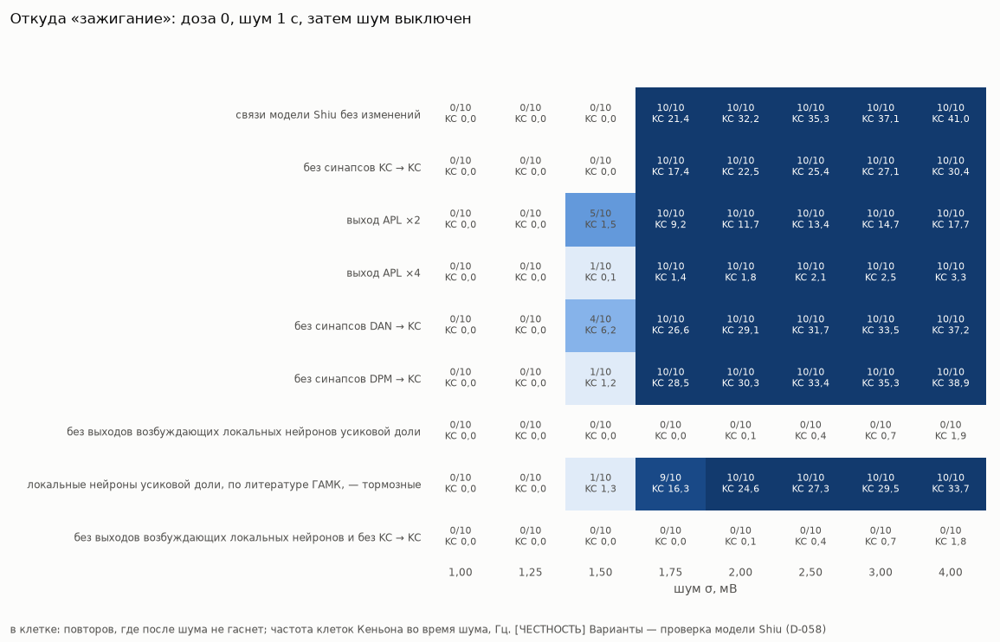
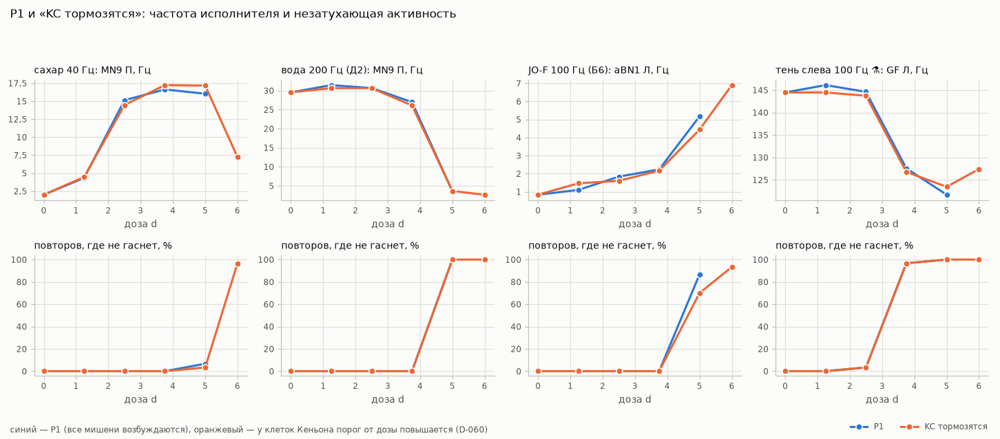
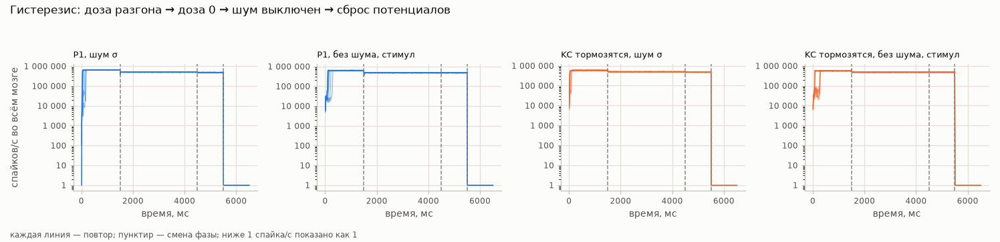

# P1b «психоделик», уточнение: таблицы

*Файл собирает команда `uv run flybrain psy` — вручную его не правят. Цель, оговорки и выводы — в [EXPERIMENT_PSY.md](../EXPERIMENT_PSY.md), раздел «P1b». Таблицы P1 — в [results.md](results.md), они не менялись.*

**[ЧЕСТНОСТЬ]** Вычислительная гипотеза, а не модель ощущений мухи. Режим «KC тормозятся», варианты связей, протокол гистерезиса — наши (D-058…D-061).

## 1. Схема грибовидных тел

Клеток Кеньона (KC) — 5 177, APL — 2 (right: медиатор gaba, знак в модели -1; left: медиатор gaba, знак в модели -1), дофаминовых нейронов (DAN) — 331, DPM — 2. Предсказанный медиатор KC: dopamine 5 172, acetylcholine 4, gaba 1 (в литературе KC — ацетилхолин; в модели знак всё равно +1). Знак DPM в модели — +1; DAN — +1: 331.

| связь | пар нейронов | синапсов со знаком модели |
|---|---|---|
| KC → KC | 293 762 | 379 338 |
| KC → APL | 5 215 | 116 878 |
| APL → KC | 5 194 | -98 654 |
| KC → DAN | 81 056 | 125 133 |
| DAN → KC | 47 404 | 60 657 |
| KC → DPM | 5 175 | 88 051 |
| DPM → KC | 4 057 | 9 280 |

В среднем на одну KC приходится синапсов (со знаком): от других KC 73,3, от проекционных нейронов усиковой доли 63,3, от APL -19,1, от DAN 11,7, от DPM 1,8.

## 2. Механизм «зажигания» (доза 0)

Доза 0, без стимула: шум мембраны σ на 1 000 мс, затем шум выключен на 500 мс. «Зажглось» — то же правило, что у разгона (D-056): через 300–500 мс после выключения шума спайков не меньше 10 % от последних 200 мс с шумом. 10 повторов. **[ЧЕСТНОСТЬ]** Варианты связей — проверка свойства модели Shiu, а не новая модель (D-058).

В клетке: в скольких повторах активность после выключения шума не гаснет; средняя частота клеток Кеньона во время шума; спайков в секунду во всём мозге через 300–500 мс после выключения шума.

| вариант связей | σ = 1,00 мВ | σ = 1,25 мВ | σ = 1,50 мВ | σ = 1,75 мВ | σ = 2,00 мВ | σ = 2,50 мВ | σ = 3,00 мВ | σ = 4,00 мВ | наименьший σ с зажиганием | σ, где зажигается хотя бы половина повторов |
|---|---|---|---|---|---|---|---|---|---|---|
| связи модели Shiu без изменений | 0 из 10; KC 0,0 Гц; после — 0/с | 0 из 10; KC 0,0 Гц; после — 0/с | 0 из 10; KC 0,0 Гц; после — 0/с | 10 из 10; KC 21,4 Гц; после — 475 950/с | 10 из 10; KC 32,2 Гц; после — 476 549/с | 10 из 10; KC 35,3 Гц; после — 477 557/с | 10 из 10; KC 37,1 Гц; после — 477 689/с | 10 из 10; KC 41,0 Гц; после — 475 982/с | 1,75 мВ | 1,75 мВ |
| без синапсов KC → KC | 0 из 10; KC 0,0 Гц; после — 0/с | 0 из 10; KC 0,0 Гц; после — 0/с | 0 из 10; KC 0,0 Гц; после — 0/с | 10 из 10; KC 17,4 Гц; после — 417 931/с | 10 из 10; KC 22,5 Гц; после — 418 611/с | 10 из 10; KC 25,4 Гц; после — 418 823/с | 10 из 10; KC 27,1 Гц; после — 419 443/с | 10 из 10; KC 30,4 Гц; после — 418 495/с | 1,75 мВ | 1,75 мВ |
| выход APL ×2 | 0 из 10; KC 0,0 Гц; после — 0/с | 0 из 10; KC 0,0 Гц; после — 0/с | 5 из 10; KC 1,5 Гц; после — 168 696/с | 10 из 10; KC 9,2 Гц; после — 337 697/с | 10 из 10; KC 11,7 Гц; после — 336 169/с | 10 из 10; KC 13,4 Гц; после — 337 294/с | 10 из 10; KC 14,7 Гц; после — 336 984/с | 10 из 10; KC 17,7 Гц; после — 336 535/с | 1,50 мВ | 1,50 мВ |
| выход APL ×4 | 0 из 10; KC 0,0 Гц; после — 0/с | 0 из 10; KC 0,0 Гц; после — 0/с | 1 из 10; KC 0,1 Гц; после — 28 241/с | 10 из 10; KC 1,4 Гц; после — 281 052/с | 10 из 10; KC 1,8 Гц; после — 281 372/с | 10 из 10; KC 2,1 Гц; после — 281 854/с | 10 из 10; KC 2,5 Гц; после — 281 120/с | 10 из 10; KC 3,3 Гц; после — 281 608/с | 1,50 мВ | 1,75 мВ |
| без синапсов DAN → KC | 0 из 10; KC 0,0 Гц; после — 0/с | 0 из 10; KC 0,0 Гц; после — 0/с | 4 из 10; KC 6,2 Гц; после — 181 785/с | 10 из 10; KC 26,6 Гц; после — 454 820/с | 10 из 10; KC 29,1 Гц; после — 454 243/с | 10 из 10; KC 31,7 Гц; после — 454 013/с | 10 из 10; KC 33,5 Гц; после — 455 742/с | 10 из 10; KC 37,2 Гц; после — 455 018/с | 1,50 мВ | 1,75 мВ |
| без синапсов DPM → KC | 0 из 10; KC 0,0 Гц; после — 0/с | 0 из 10; KC 0,0 Гц; после — 0/с | 1 из 10; KC 1,2 Гц; после — 46 348/с | 10 из 10; KC 28,5 Гц; после — 463 958/с | 10 из 10; KC 30,3 Гц; после — 463 662/с | 10 из 10; KC 33,4 Гц; после — 463 214/с | 10 из 10; KC 35,3 Гц; после — 463 931/с | 10 из 10; KC 38,9 Гц; после — 464 218/с | 1,50 мВ | 1,75 мВ |
| без выходов возбуждающих локальных нейронов усиковой доли | 0 из 10; KC 0,0 Гц; после — 0/с | 0 из 10; KC 0,0 Гц; после — 0/с | 0 из 10; KC 0,0 Гц; после — 0/с | 0 из 10; KC 0,0 Гц; после — 0/с | 0 из 10; KC 0,1 Гц; после — 378/с | 0 из 10; KC 0,4 Гц; после — 1 138/с | 0 из 10; KC 0,7 Гц; после — 1 522/с | 0 из 10; KC 1,9 Гц; после — 570/с | не зажигается | — |
| локальные нейроны усиковой доли, по литературе ГАМК, — тормозные | 0 из 10; KC 0,0 Гц; после — 0/с | 0 из 10; KC 0,0 Гц; после — 0/с | 1 из 10; KC 1,3 Гц; после — 36 723/с | 9 из 10; KC 16,3 Гц; после — 332 023/с | 10 из 10; KC 24,6 Гц; после — 368 602/с | 10 из 10; KC 27,3 Гц; после — 368 664/с | 10 из 10; KC 29,5 Гц; после — 367 903/с | 10 из 10; KC 33,7 Гц; после — 368 719/с | 1,50 мВ | 1,75 мВ |
| без выходов возбуждающих локальных нейронов и без KC → KC | 0 из 10; KC 0,0 Гц; после — 0/с | 0 из 10; KC 0,0 Гц; после — 0/с | 0 из 10; KC 0,0 Гц; после — 0/с | 0 из 10; KC 0,0 Гц; после — 0/с | 0 из 10; KC 0,1 Гц; после — 190/с | 0 из 10; KC 0,4 Гц; после — 379/с | 0 из 10; KC 0,7 Гц; после — 1 131/с | 0 из 10; KC 1,8 Гц; после — 1 474/с | не зажигается | — |

Разгон от дозы (P1, сахар 40 Гц, без шума, правило D-056) в исходной модели и в варианте «без выходов возбуждающих локальных нейронов усиковой доли» — повторов, где активность после стимула не гаснет:

| доза d | исходная модель | без выходов возбуждающих локальных нейронов усиковой доли |
|---|---|---|
| 5 | 1 из 10 (357 активных) | 0 из 10 (362 активных) |
| 6 | 9 из 10 (10 341 активных) | 7 из 10 (1 988 активных) |
| 8 | 10 из 10 (13 104 активных) | 10 из 10 (5 559 активных) |
| 10 | 10 из 10 (16 104 активных) | 10 из 10 (9 227 активных) |
| 15 | 10 из 10 (21 905 активных) | 10 из 10 (16 567 активных) |

Исходная модель, σ = 1,75 мВ: кто стреляет через 0–500 мс после выключения шума (класс клеток, нейронов): Kenyon_Cell 3 386, central 2 710, ALPN 554, LHLN 452, olfactory 361, ALLN 361, descending 191, DAN 148, прочие 463.

## 3. Единицы дозы

Снижение порога = d · ΔV · h(s), ΔV = 1,0 мВ (D-055). У мишени с медианным числом серотониновых синапсов (s = 2, h = 0,286) и с наибольшим (s = 1 074, h = 0,995); в скобках — доля зазора «покой — порог» 7 мВ. В режиме «KC тормозятся» у клеток Кеньона на столько же порог **повышается**.

| доза d | мишень с медианным s | мишень с наибольшим s |
|---|---|---|
| 0 | 0,00 мВ (0 %) | 0,00 мВ (0 %) |
| 1,25 | 0,36 мВ (5 %) | 1,24 мВ (18 %) |
| 2,5 | 0,71 мВ (10 %) | 2,49 мВ (36 %) |
| 3,75 | 1,07 мВ (15 %) | 3,73 мВ (53 %) |
| 5 | 1,43 мВ (20 %) | 4,98 мВ (71 %) |
| 6 | 1,71 мВ (24 %) | 5,97 мВ (85 %) |
| 7 | 2,00 мВ (29 %) | 6,97 мВ (100 %) |

## 4. Режим «KC тормозятся»: сравнение с P1

У клеток Кеньона порог от дозы повышается на d · ΔV · h(s), у остальных мишеней — снижается, как в P1 (D-060). 30 повторов, строгий критерий, те же стимулы и метрики. В клетке — P1 / KC тормозятся.

- Доза разгона (P1: все мишени возбуждаются, сахар 40 Гц, 10 повторов): **5**.
- Доза разгона (P1b: KC тормозятся, сахар 40 Гц, 10 повторов): **6**.

Поиск дозы разгона в режиме «KC тормозятся»:

| доза d | откликнулось (Б2) | активных (≥ 1 Гц) | повторов, где не гаснет |
|---|---|---|---|
| 0 | 250 | 75 | 0 из 10 |
| 0,5 | 177 | 58 | 0 из 10 |
| 1 | 298 | 105 | 0 из 10 |
| 1,5 | 323 | 129 | 0 из 10 |
| 2 | 345 | 202 | 0 из 10 |
| 2,5 | 393 | 289 | 0 из 10 |
| 3 | 401 | 297 | 0 из 10 |
| 4 | 431 | 305 | 0 из 10 |
| 5 | 514 | 318 | 0 из 10 |
| 6 | 10 721 | 9 755 | 10 из 10 |
| 7 | 11 417 | 10 302 | 10 из 10 |
| 8 | 12 727 | 12 118 | 10 из 10 |
| 10 | 15 511 | 15 072 | 10 из 10 |
| 12 | 17 764 | 17 339 | 10 из 10 |
| 15 | 20 483 | 20 117 | 10 из 10 |
| 20 | 25 305 | 25 015 | 10 из 10 |
| 25 | 28 901 | 28 678 | 10 из 10 |
| 30 | 28 891 | 28 645 | 10 из 10 |

### сахар 40 Гц — «исполнитель» MN9 П

| доза d | откликнулось (Б2) | активных | эффективное число нейронов | MN9 П | в зрительной системе | повторов из 30, где не гаснет |
|---|---|---|---|---|---|---|
| 0 | 271 / 271 | 71 / 71 | 54 / 54 | 2,0 ± 0,4 Гц / 2,0 ± 0,4 Гц | 0 / 0 | 0 / 0 |
| 1,25 | 346 / 323 | 125 / 129 | 86 / 89 | 4,3 ± 0,6 Гц / 4,5 ± 0,6 Гц | 4 / 2 | 0 / 0 |
| 2,5 | 407 / 404 | 282 / 281 | 189 / 188 | 15,1 ± 0,8 Гц / 14,5 ± 0,8 Гц | 4 / 4 | 0 / 0 |
| 3,75 | 449 / 434 | 297 / 293 | 200 / 193 | 16,6 ± 0,8 Гц / 17,2 ± 0,7 Гц | 4 / 4 | 0 / 0 |
| 5 | 10 640 / 9 627 | 6 385 / 946 | 5 557 / 2 103 | 16,0 ± 1,1 Гц / 17,2 ± 0,7 Гц | 374 / 276 | 2 / 1 |
| 6 | — / 11 204 | — / 9 769 | — / 6 760 | — / 7,2 ± 0,7 Гц | — / 530 | — / 29 |

### вода 200 Гц (Д2) — «исполнитель» MN9 П

| доза d | откликнулось (Б2) | активных | эффективное число нейронов | MN9 П | в зрительной системе | повторов из 30, где не гаснет |
|---|---|---|---|---|---|---|
| 0 | 353 / 353 | 203 / 203 | 114 / 114 | 29,5 ± 1,0 Гц / 29,5 ± 1,0 Гц | 2 / 2 | 0 / 0 |
| 1,25 | 398 / 391 | 257 / 237 | 135 / 127 | 31,4 ± 1,0 Гц / 30,6 ± 0,9 Гц | 2 / 4 | 0 / 0 |
| 2,5 | 453 / 477 | 296 / 299 | 161 / 164 | 30,7 ± 0,7 Гц / 30,6 ± 0,9 Гц | 5 / 5 | 0 / 0 |
| 3,75 | 697 / 1 340 | 353 / 360 | 195 / 210 | 27,0 ± 0,9 Гц / 26,1 ± 0,7 Гц | 37 / 46 | 0 / 0 |
| 5 | 11 426 / 11 004 | 10 095 / 9 595 | 7 361 / 6 694 | 3,6 ± 0,3 Гц / 3,6 ± 0,2 Гц | 468 / 470 | 30 / 30 |
| 6 | — / 11 779 | — / 10 017 | — / 6 827 | — / 2,7 ± 0,2 Гц | — / 544 | — / 30 |

### JO-F 100 Гц (Б6) — «исполнитель» aBN1 Л

| доза d | откликнулось (Б2) | активных | эффективное число нейронов | aBN1 Л | в зрительной системе | повторов из 30, где не гаснет |
|---|---|---|---|---|---|---|
| 0 | 96 / 96 | 22 / 22 | 16 / 16 | 0,83 ± 0,16 Гц / 0,83 ± 0,16 Гц | 0 / 0 | 0 / 0 |
| 1,25 | 98 / 97 | 24 / 26 | 16 / 16 | 1,1 ± 0,2 Гц / 1,5 ± 0,2 Гц | 0 / 0 | 0 / 0 |
| 2,5 | 99 / 106 | 26 / 26 | 17 / 17 | 1,8 ± 0,3 Гц / 1,6 ± 0,2 Гц | 0 / 0 | 0 / 0 |
| 3,75 | 101 / 109 | 32 / 30 | 17 / 17 | 2,2 ± 0,2 Гц / 2,2 ± 0,3 Гц | 0 / 0 | 0 / 0 |
| 5 | 11 139 / 10 534 | 9 689 / 9 018 | 7 259 / 6 577 | 5,2 ± 0,5 Гц / 4,4 ± 0,3 Гц | 461 / 451 | 26 / 21 |
| 6 | — / 11 632 | — / 10 036 | — / 6 815 | — / 6,9 ± 0,4 Гц | — / 543 | — / 28 |

### тень слева 100 Гц ⚗ — «исполнитель» GF Л

| доза d | откликнулось (Б2) | активных | эффективное число нейронов | GF Л | в зрительной системе | повторов из 30, где не гаснет |
|---|---|---|---|---|---|---|
| 0 | 900 / 900 | 522 / 522 | 315 / 315 | 144,5 ± 0,4 Гц / 144,5 ± 0,4 Гц | 80 / 80 | 0 / 0 |
| 1,25 | 1 034 / 1 071 | 617 / 603 | 345 / 341 | 146,1 ± 0,5 Гц / 144,5 ± 0,4 Гц | 89 / 99 | 0 / 0 |
| 2,5 | 9 687 / 9 653 | 4 181 / 4 399 | 1 638 / 1 716 | 144,6 ± 0,6 Гц / 143,7 ± 0,7 Гц | 286 / 297 | 1 / 1 |
| 3,75 | 11 062 / 10 691 | 9 689 / 9 333 | 7 156 / 6 641 | 127,6 ± 1,4 Гц / 126,8 ± 1,3 Гц | 459 / 438 | 29 / 29 |
| 5 | 11 633 / 11 214 | 10 239 / 9 748 | 7 426 / 6 762 | 121,7 ± 0,7 Гц / 123,5 ± 0,8 Гц | 544 / 540 | 30 / 30 |
| 6 | — / 11 945 | — / 10 240 | — / 6 936 | — / 127,4 ± 0,9 Гц | — / 616 | — / 30 |

## 5. Порог «исполнителей»: P1 и «KC тормозятся»

10 повторов на точку; порог — наименьшая частота стимула, при которой «исполнитель» активен (≥ 1 Гц).

| стимул → исполнитель, Гц: P1 / KC тормозятся | d = 0 | d = 1,25 | d = 2,5 | d = 3,75 |
|---|---|---|---|---|
| сахар → MN9 П | 34 / 34 | 31 / 31 | 23 / 22 | 22 / — |
| вода → MN9 П | 128 / 128 | 120 / 125 | 108 / 116 | 102 / — |
| JO-F → aBN1 Л | 155 / 155 | 100 / 115 | 56 / ≤ 50 | ≤ 50 / — |
| тень слева ⚗ → GF Л | 6 / 6 | ≤ 5 / ≤ 5 | ≤ 5 / ≤ 5 | ≤ 5 / — |

## 6. Без стимула, шум σ = 1 мВ

Активных нейронов (≥ 1 Гц; в скобках — средняя частота по мозгу), 10 повторов, первые 200 мс не считаются.

| доза d | P1 | KC тормозятся |
|---|---|---|
| 0 | 0 (0,00 Гц) | 0 (0,00 Гц) |
| 1,25 | 0 (0,00 Гц) | 0 (0,00 Гц) |
| 2,5 | 0 (0,00 Гц) | 8 316 (0,32 Гц) |
| 3,75 | 11 318 (3,81 Гц) | 10 890 (3,43 Гц) |
| 5 | 12 158 (4,61 Гц) | 11 730 (3,98 Гц) |
| 6 | — | 12 352 (4,18 Гц) |

## 7. Гистерезис: гаснет ли сеть, когда доза возвращается в 0

Фазы: A — доза разгона режима 1 500 мс; B — доза 0 на 3 000 мс (стимул выключен, шум прежний); C — шум выключен на 1 000 мс; D — потенциалы сброшены в покой, шум снова включён на 1 000 мс. «Горит» — больше 100 000 спайков в секунду во всём мозге в последние 100 мс фазы; «погасла» — меньше 1 000 и до конца фазы не поднимается. Протокол без шума зажигает сеть стимулом «тень слева 100 Гц ⚗». 10 повторов.

| режим | протокол | доза разгона | σ, мВ | горит: доза разгона | горит: доза 0 | горит: доза 0, шум выключен | горит: после сброса потенциалов | после возврата дозы в 0 (среди зажёгшихся) |
|---|---|---|---|---|---|---|---|---|
| P1 | с шумом σ, без стимула | 5 | 1 | 10 из 10 | 10 из 10 | 10 из 10 | 0 из 10 | погасла в 0 из 10 |
| P1 | без шума, зажигание стимулом | 5 | 0 | 10 из 10 | 10 из 10 | 10 из 10 | 0 из 10 | погасла в 0 из 10 |
| KC тормозятся | с шумом σ, без стимула | 6 | 1 | 10 из 10 | 10 из 10 | 10 из 10 | 0 из 10 | погасла в 0 из 10 |
| KC тормозятся | без шума, зажигание стимулом | 6 | 0 | 10 из 10 | 10 из 10 | 10 из 10 | 0 из 10 | погасла в 0 из 10 |

## 8. Как получено

- Движок — тот же, что в P1 и в проверке C6 (версия кода `5adcecdc9651`): P1b его не менял.
- Режим «KC тормозятся» при дозе 0 и варианты связей «base» — это ровно расчёты P1 (тот же ключ и то же зерно); тест `tests/test_psy.py`.
- Расчётов P1b: 165; один — от 14 до 69 с. Код — `flybrain/psymech.py`, `flybrain/p1breport.py`, настройки — раздел `p1b` в `config/psy.yaml`.

## Картинки

*Механизм «зажигания»: доля повторов, где активность не гаснет после выключения шума*

*P1 и «KC тормозятся»: исполнители и незатухающая активность*

*Гистерезис: активность мозга, когда доза возвращается в 0*
