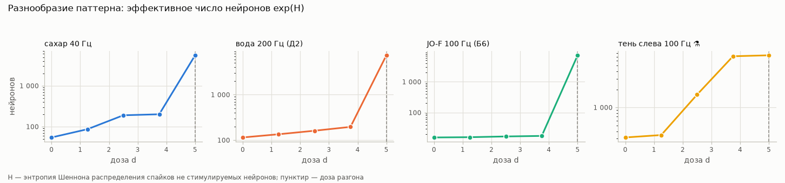
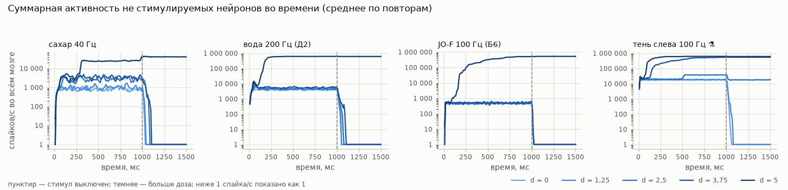

# P1 «психоделик»: таблицы

*Файл собирает команда `uv run flybrain psy` — вручную его не правят. Цель, оговорки и выводы — в [EXPERIMENT_PSY.md](../EXPERIMENT_PSY.md).*

**[ЧЕСТНОСТЬ]** Вычислительная гипотеза: нейроны с серотониновым входом становятся возбудимее, как от агониста 5-HT2A. Это не модель того, что «чувствует» муха. Выбор серотониновых нейронов, форма эффекта, параметры и метрики — наши (D-053…D-056), а не данные коннектома.

## 1. Разведка данных

### 1.1. Как хранится медиатор

В данных проекта медиатор — **на уровне нейрона**, а не синапса: столбец `top_nt` таблицы аннотаций FlyWire (самый частый медиатор, предсказанный по снимкам синапсов этого нейрона, Eckstein et al. 2024) с уверенностью `top_nt_conf`, и столбец `known_nt` — медиатор из литературы со ссылкой `known_nt_source`. Предсказаний для отдельных синапсов в скачанных файлах нет. В файле связей Shiu есть только знак отправителя (+1 / −1), одинаковый для всех его синапсов.

### 1.2. Какой знак и вес получают синапсы в движке

Знак берётся из файла связей Shiu (D-025), вес — число синапсов × 0,275 мВ для любого медиатора (D-005). Таблица — нейроны модели по предсказанному медиатору:

| предсказанный медиатор | нейронов | знак +1 (возбуждает) | знак −1 (тормозит) | знак 0 (нет выходов) | медианная уверенность |
|---|---|---|---|---|---|
| ацетилхолин | 86 025 | 84 162 | 1 719 | 144 | 0,72 |
| ГАМК | 19 147 | 1 348 | 17 731 | 68 | 0,69 |
| глутамат | 24 858 | 2 941 | 21 863 | 54 | 0,60 |
| дофамин | 5 905 | 5 897 | 3 | 5 | 0,64 |
| серотонин | 2 201 | 2 127 | 9 | 65 | 0,49 |
| октопамин | 210 | 192 | 1 | 17 | 0,42 |
| не предсказан | 293 | 5 | 7 | 281 | — |

Дофамин, серотонин и октопамин в модели Shiu — **обычные быстрые возбуждающие синапсы** с тем же весом 0,275 мВ на синапс, что у ацетилхолина. Это логика Shiu (правило «ГАМК и глутамат тормозят, остальные возбуждают», D-005), а не наше решение; единичные исключения — от другой версии предсказания медиатора (D-025). Медленного модулирующего действия моноаминов в модели нет.

### 1.3. Серотониновые нейроны

Литература: около 100 во всей нервной системе (обзорная оценка) (Alekseyenko et al., Curr Biol 2014), 83 на полушарие в мозге и подглоточном ганглии, то есть около 166 (окраска на серотонин и триптофангидроксилазу) (Bao et al., Cell Tissue Res 2010).

| критерий | нейронов в модели | от числа в литературе | из них предсказан серотонин | знак в модели: + / − |
|---|---|---|---|---|
| строгий: окраска или клоны из серотониновых линий | 62 | 0,4–0,6× | 11 | 50 / 12 |
| широкий: любая ссылка в литературе | 197 | 1,2–2,0× | 18 | 143 / 54 |
| по предсказанию медиатора | 2 201 | 13,3–22,0× | 2 201 | 2 127 / 9 |

- Предсказание и литература почти не совпадают: из 197 нейронов, у которых серотонин указан в литературе, предсказан серотонин только у 18. Их предсказания: ацетилхолин 72, глутамат 54, дофамин 48, серотонин 18, ГАМК 4, октопамин 1.
- Из 2 201 нейронов с предсказанным серотонином 1 481 — сенсорные. Литературный медиатор указан у 1 245 из них: ацетилхолин — у 766, гистамин (его нет среди шести медиаторов, которые умеет предсказывать сеть) — у 345, серотонин — у 18.

Типы клеток с серотонином в литературе (столбец «строгий» — входят ли в основной набор):

| тип клетки | нейронов | строгий | чем подтверждён серотонин | предсказанный медиатор | суперкласс |
|---|---|---|---|---|---|
| 5-HTPMPD01 | 2 | ✅ | immuno | дофамин 2 | центральные |
| 5-HTPMPV01 | 2 | ✅ | immuno | дофамин 1, серотонин 1 | центральные |
| 5-HTPMPV03 | 2 | ✅ | immuno | дофамин 2 | зрительные центробежные |
| AC neuron | 4 | ✅ | mcfo | ацетилхолин 4 | центральные |
| AVLP538 | 2 | ✅ | mcfo | дофамин 2 | центральные |
| AVLP544 | 2 | ✅ | mcfo | ГАМК 2 | центральные |
| CB0212 | 2 | ✅ | immuno | серотонин 2 | центральные |
| CB0262 | 2 | ✅ | immuno | серотонин 1, дофамин 1 | центральные |
| CB0892 | 2 | ✅ | immuno | дофамин 2 | центральные |
| CL344 | 2 | ✅ | mcfo | дофамин 2 | центральные |
| CL352 | 2 | ✅ | mcfo | глутамат 1, ацетилхолин 1 | центральные |
| CL360 | 2 | ✅ | mcfo | серотонин 1, ацетилхолин 1 | центральные |
| CSD | 2 | ✅ | immuno | серотонин 2 | центральные |
| DNg26 | 4 | — | unknown | серотонин 4 | нисходящие |
| DNg28 | 4 | ✅ | immuno | ГАМК 2, ацетилхолин 1, октопамин 1 | нисходящие |
| DNg30 | 2 | ✅ | immuno | серотонин 2 | нисходящие |
| DPM | 2 | ✅ | immuno, scrna-seq | дофамин 2 | центральные |
| Delta7 | 40 | — | easi-fish | глутамат 39, ацетилхолин 1 | центральные |
| ExR3 | 2 | ✅ | easi-fish, immuno | дофамин 2 | центральные |
| FB1H | 2 | ✅ | mcfo | дофамин 2 | центральные |
| FB2B | 3 | — | easi-fish | глутамат 2, серотонин 1 | центральные |
| FB2B_b | 4 | — | easi-fish | глутамат 4 | центральные |
| FB4M | 4 | — | easi-fish | дофамин 4 | центральные |
| FB4Y | 6 | — | easi-fish | дофамин 5, серотонин 1 | центральные |
| FB6H | 2 | ✅ | immuno | глутамат 2 | центральные |
| FB7B | 2 | — | easi-fish | глутамат 2 | центральные |
| FC3 | 40 | — | easi-fish | ацетилхолин 40 | центральные |
| IB118 | 2 | ✅ | mcfo | серотонин 2 | центральные |
| LAL125,LAL108 | 4 | ✅ | mcfo | глутамат 4 | центральные |
| PDt1 | 11 | — | easi-fish | дофамин 11 | зрительные доли |
| SIP087 | 2 | ✅ | mcfo | дофамин 2 | центральные |
| SMP039 | 4 | ✅ | mcfo | дофамин 4 | центральные |
| SMP384 | 2 | ✅ | mcfo | дофамин 2 | центральные |
| SMP503 | 2 | ✅ | mcfo | дофамин 2 | центральные |
| SMP504 | 2 | ✅ | mcfo | ацетилхолин 2 | центральные |
| SMP505 | 2 | ✅ | mcfo | ацетилхолин 2 | центральные |
| hDeltaC | 21 | — | easi-fish | ацетилхолин 20, серотонин 1 | центральные |

### 1.4. Мишени: серотониновые синапсы на нейрон

s_i — сколько синапсов нейрон i получает от серотониновых нейронов.

| критерий | источников | их выходных синапсов | мишеней (s > 0) | медиана s у мишеней | s = 1 | s = 2–4 | s = 5–19 | s = 20–99 | s ≥ 100 |
|---|---|---|---|---|---|---|---|---|---|
| строгий: окраска или клоны из серотониновых линий | 62 | 104 243 | 21 619 | 2 | 9 401 | 8 204 | 3 185 | 739 | 90 |
| широкий: любая ссылка в литературе | 197 | 188 629 | 27 047 | 2 | 12 355 | 9 055 | 3 719 | 1 628 | 290 |
| по предсказанию медиатора | 2 201 | 436 206 | 29 069 | 2 | 10 902 | 8 646 | 6 602 | 2 268 | 651 |

Мишени по суперклассам — критерий «строгий: окраска или клоны из серотониновых линий»:

| суперкласс | нейронов | мишеней (s > 0) | доля класса | мишеней с s ≥ 5 | доля серотониновых синапсов |
|---|---|---|---|---|---|
| центральные | 32 379 | 17 765 | 54,9 % | 3 741 | 89,7 % |
| нисходящие | 1 299 | 373 | 28,7 % | 100 | 2,6 % |
| восходящие | 1 736 | 188 | 10,8 % | 46 | 2,5 % |
| зрительные доли | 77 530 | 1 723 | 2,2 % | 23 | 2,1 % |
| зрительные проекционные | 8 038 | 1 071 | 13,3 % | 35 | 1,8 % |
| зрительные центробежные | 524 | 200 | 38,2 % | 48 | 0,7 % |
| сенсорные | 16 352 | 211 | 1,3 % | 6 | 0,3 % |
| моторные | 110 | 35 | 31,8 % | 14 | 0,2 % |
| эндокринные | 76 | 28 | 36,8 % | 1 | 0,0 % |
| сенсорные восходящие | 581 | 23 | 4,0 % | 0 | 0,0 % |
| без аннотации | 14 | 2 | 14,3 % | 0 | 0,0 % |

Больше всего серотониновых синапсов получают типы: KCg-m (3 021), KCab (2 803), APL (1 776), ER3d (1 754), KCapbp-m (1 252), LAL081 (1 180), lLN2F_b (1 168), PFGs (1 140), MBON09 (869), hDeltaK (848).

Мишени по суперклассам — критерий «широкий: любая ссылка в литературе»:

| суперкласс | нейронов | мишеней (s > 0) | доля класса | мишеней с s ≥ 5 | доля серотониновых синапсов |
|---|---|---|---|---|---|
| центральные | 32 379 | 18 842 | 58,2 % | 5 222 | 89,6 % |
| зрительные доли | 77 530 | 5 964 | 7,7 % | 136 | 5,6 % |
| нисходящие | 1 299 | 400 | 30,8 % | 106 | 1,5 % |
| восходящие | 1 736 | 196 | 11,3 % | 46 | 1,4 % |
| зрительные проекционные | 8 038 | 1 130 | 14,1 % | 42 | 1,1 % |
| зрительные центробежные | 524 | 210 | 40,1 % | 63 | 0,5 % |
| сенсорные | 16 352 | 213 | 1,3 % | 6 | 0,2 % |
| моторные | 110 | 37 | 33,6 % | 14 | 0,1 % |
| эндокринные | 76 | 28 | 36,8 % | 1 | 0,0 % |
| сенсорные восходящие | 581 | 24 | 4,1 % | 0 | 0,0 % |
| без аннотации | 14 | 3 | 21,4 % | 1 | 0,0 % |

Больше всего серотониновых синапсов получают типы: PFGs (4 130), PFR (4 092), PFL1 (3 544), Delta7 (3 300), PFNa (3 286), KCg-m (3 021), KCab (2 803), FC2B (2 739), PFL3 (2 583), Dm18 (2 505).

Ключевые нейроны — их собственные серотониновые синапсы:

| нейрон | номер FlyWire | s (строгий) | s (широкий) | s (по предсказанию медиатора) |
|---|---|---|---|---|
| MN9 Л | 720575940618238523 | 0 | 0 | 50 |
| MN9 П | 720575940660219265 | 0 | 1 | 29 |
| aBN1 Л | 720575940630907434 | 2 | 2 | 4 |
| aBN1 П | 720575940642666971 | 0 | 0 | 5 |
| GF Л | 720575940622838154 | 0 | 0 | 6 |
| GF П | 720575940632499757 | 0 | 0 | 79 |
| aDN1 Л | 720575940624319124 | 0 | 0 | 32 |
| aDN1 П | 720575940616185531 | 1 | 1 | 60 |
| aDN2 Л | 720575940636308075 | 0 | 0 | 228 |
| aDN2 П | 720575940629806974 | 0 | 0 | 242 |

## 2. Механизм и параметры

Порог нейрона i: V_th,i = −45 мВ − d · ΔV · h(s_i), h(s) = s / (s + s_half); ΔV = 1,0 мВ, s_half = 5; основной критерий — «строгий: окраска или клоны из серотониновых линий». Веса связей не меняются; при d = 0 порог у всех −45 мВ, как у Shiu.

| s (синапсов) | h(s) |
|---|---|
| 1 | 0,17 |
| 2 | 0,29 |
| 5 | 0,50 |
| 20 | 0,80 |
| 100 | 0,95 |
| 1 000 | 1,00 |

При дозе 1 порог снижен у 21 619 нейронов: больше чем на 0,5 мВ — у 3 186, больше чем на 0,8 мВ — у 792; наибольшее снижение — 0,995 мВ. Без шума нейрон в покое (−52 мВ) сам не выстрелит, пока порог не опустится ниже покоя: d · ΔV · h > 7 мВ, то есть при d > 7,03 у самого «нагруженного» нейрона.

## 3. Поиск дозы разгона

Стимул — сахар 40 Гц, 10 повторов: 1 с со стимулом, затем 500 мс без него. **Разгон** (правило D-056, записано до расчётов): за 300–500 мс после выключения стимула спайков не стимулируемых нейронов не меньше 10 % от последних 200 мс стимула. Без шума модель Shiu после выключения стимула затихает, так что любая поздняя активность — самоподдерживающаяся.

### Критерий «строгий: окраска или клоны из серотониновых линий»

Доза разгона: **5**.

| доза d | откликнулось (> 0 Гц, со стимулируемыми) | активных (≥ 1 Гц) | эффективное число нейронов | спайков/с в конце стимула | спайков/с после | после / конец стимула | повторов, где не гаснет | нейронов после стимула | разгон |
|---|---|---|---|---|---|---|---|---|---|
| 0 | 250 | 75 | 58 | 712 | 0 | 0,0 % | 0 из 10 | 14 | нет |
| 0,5 | 309 | 108 | 74 | 829 | 0 | 0,0 % | 0 из 10 | 23 | нет |
| 1 | 291 | 94 | 68 | 978 | 0 | 0,0 % | 0 из 10 | 28 | нет |
| 1,5 | 351 | 175 | 115 | 1 017 | 0 | 0,0 % | 0 из 10 | 42 | нет |
| 2 | 334 | 157 | 106 | 837 | 0 | 0,0 % | 0 из 10 | 76 | нет |
| 2,5 | 399 | 280 | 187 | 2 748 | 0 | 0,0 % | 0 из 10 | 252 | нет |
| 3 | 396 | 292 | 195 | 2 695 | 0 | 0,0 % | 0 из 10 | 171 | нет |
| 4 | 422 | 293 | 193 | 3 633 | 0 | 0,0 % | 0 из 10 | 209 | нет |
| 5 | 3 579 | 357 | 334 | 7 642 | 61 167 | 800,4 % | 1 из 10 | 9 970 | 🔥 да |
| 6 | 11 429 | 10 341 | 7 570 | 587 934 | 587 075 | 99,9 % | 9 из 10 | 10 808 | 🔥 да |
| 7 | 12 092 | 11 103 | 7 754 | 700 017 | 697 202 | 99,6 % | 10 из 10 | 11 614 | 🔥 да |
| 8 | 13 705 | 13 104 | 8 430 | 1 070 639 | 1 070 747 | 100,0 % | 10 из 10 | 13 258 | 🔥 да |
| 10 | 16 527 | 16 104 | 10 192 | 1 808 957 | 1 806 494 | 99,9 % | 10 из 10 | 16 238 | 🔥 да |
| 12 | 19 317 | 18 918 | 12 150 | 2 468 586 | 2 464 839 | 99,8 % | 10 из 10 | 19 056 | 🔥 да |
| 15 | 22 216 | 21 905 | 14 430 | 3 476 516 | 3 473 358 | 99,9 % | 10 из 10 | 22 027 | 🔥 да |
| 20 | 26 926 | 26 682 | 17 912 | 5 226 533 | 5 219 458 | 99,9 % | 10 из 10 | 26 800 | 🔥 да |

Кто стреляет через 0–500 мс после стимула при дозе 5 (класс клеток, нейронов): Kenyon_Cell 3 637, central 3 134, ALPN 562, olfactory 462, LHLN 449, ALLN 370, CX 333, descending 224, прочие 799.

Кто стреляет через 0–500 мс после стимула при дозе 6 (класс клеток, нейронов): Kenyon_Cell 3 659, central 3 628, ALPN 564, olfactory 520, LHLN 451, CX 384, ALLN 374, descending 264, прочие 964.

### Критерий «широкий: любая ссылка в литературе»

Доза разгона: **5**.

| доза d | откликнулось (> 0 Гц, со стимулируемыми) | активных (≥ 1 Гц) | эффективное число нейронов | спайков/с в конце стимула | спайков/с после | после / конец стимула | повторов, где не гаснет | нейронов после стимула | разгон |
|---|---|---|---|---|---|---|---|---|---|
| 0 | 246 | 82 | 59 | 796 | 0 | 0,0 % | 0 из 10 | 76 | нет |
| 0,5 | 208 | 67 | 49 | 811 | 0 | 0,0 % | 0 из 10 | 31 | нет |
| 1 | 215 | 70 | 52 | 804 | 0 | 0,0 % | 0 из 10 | 31 | нет |
| 1,5 | 312 | 124 | 84 | 973 | 0 | 0,0 % | 0 из 10 | 14 | нет |
| 2 | 351 | 198 | 128 | 2 003 | 0 | 0,0 % | 0 из 10 | 214 | нет |
| 2,5 | 391 | 277 | 182 | 2 759 | 0 | 0,0 % | 0 из 10 | 185 | нет |
| 3 | 398 | 295 | 197 | 3 262 | 0 | 0,0 % | 0 из 10 | 262 | нет |
| 4 | 438 | 309 | 206 | 3 717 | 0 | 0,0 % | 0 из 10 | 289 | нет |
| 5 | 11 883 | 10 096 | 8 042 | 135 868 | 131 625 | 96,9 % | 2 из 10 | 11 244 | 🔥 да |
| 6 | 13 414 | 11 900 | 8 726 | 563 622 | 659 097 | 116,9 % | 9 из 10 | 12 632 | 🔥 да |
| 7 | 13 802 | 12 814 | 8 769 | 846 753 | 844 498 | 99,7 % | 10 из 10 | 13 089 | 🔥 да |
| 8 | 15 692 | 15 126 | 9 194 | 1 564 147 | 1 563 508 | 100,0 % | 10 из 10 | 15 214 | 🔥 да |
| 10 | 19 806 | 19 315 | 11 789 | 2 546 486 | 2 544 503 | 99,9 % | 10 из 10 | 19 505 | 🔥 да |
| 12 | 23 202 | 22 748 | 14 123 | 3 267 374 | 3 265 492 | 99,9 % | 10 из 10 | 22 895 | 🔥 да |
| 15 | 26 322 | 25 993 | 16 811 | 4 346 670 | 4 343 691 | 99,9 % | 10 из 10 | 26 077 | 🔥 да |
| 20 | 29 418 | 29 195 | 20 084 | 6 157 293 | 6 150 807 | 99,9 % | 10 из 10 | 29 263 | 🔥 да |

Кто стреляет через 0–500 мс после стимула при дозе 5 (класс клеток, нейронов): Kenyon_Cell 3 601, central 3 546, CX 815, ALPN 563, olfactory 468, LHLN 451, ALLN 370, ME>LA 301, прочие 1 129.

Кто стреляет через 0–500 мс после стимула при дозе 6 (класс клеток, нейронов): central 4 017, Kenyon_Cell 3 711, CX 1 287, ALPN 567, olfactory 520, LHLN 453, ME>LA 402, ALLN 374, прочие 1 301.

## 4. Основной опыт

30 повторов по 1 000 мс со стимулом, затем 500 мс без него; критерий — «строгий: окраска или клоны из серотониновых линий». Доза 5 — доза разгона, найденная для стимула «сахар 40 Гц» (раздел 3), отмечена 🔥. «Повторов, где активность не гаснет» — правило разгона D-056 в каждом повторе отдельно. «Откликнулся» — правило Б2: больше 0 Гц за все повторы, вместе со стимулируемыми; распределения ниже — без стимулируемых. Эффективное число нейронов — exp(H), H — энтропия Шеннона распределения спайков не стимулируемых нейронов (D-056).

### сахар 40 Гц — «исполнитель» MN9 П

| доза d | откликнулось (Б2) | активных (≥ 1 Гц) | эффективное число нейронов | MN9 П | энтропия модальностей, бит | чужие модальности | в зрительной системе | повторов, где активность не гаснет |
|---|---|---|---|---|---|---|---|---|
| 0 | 271 | 71 | 54 | 2,0 ± 0,4 Гц | 1,25 | 81 % | 0 | 0 из 30 |
| 1,25 | 346 | 125 | 86 | 4,3 ± 0,6 Гц | 1,40 | 82 % | 4 | 0 из 30 |
| 2,5 | 407 | 282 | 189 | 15,1 ± 0,8 Гц | 1,48 | 84 % | 4 | 0 из 30 |
| 3,75 | 449 | 297 | 200 | 16,6 ± 0,8 Гц | 1,57 | 84 % | 4 | 0 из 30 |
| 5 🔥 | 10 640 | 6 385 | 5 557 | 16,0 ± 1,1 Гц | 1,09 | 99 % | 374 | 2 из 30 |

Все ключевые нейроны:

| доза d | MN9 Л | MN9 П | aBN1 Л | aBN1 П | GF Л | GF П | aDN1 Л | aDN1 П | aDN2 Л | aDN2 П |
|---|---|---|---|---|---|---|---|---|---|---|
| 0 | 1,8 ± 0,4 Гц | 2,0 ± 0,4 Гц | 0,0 Гц | 0,0 Гц | 0,0 Гц | 0,0 Гц | 0,0 Гц | 0,0 Гц | 0,0 Гц | 0,0 Гц |
| 1,25 | 4,0 ± 0,6 Гц | 4,3 ± 0,6 Гц | 0,0 Гц | 0,0 Гц | 0,0 Гц | 0,0 Гц | 0,0 Гц | 0,0 Гц | 0,0 Гц | 0,0 Гц |
| 2,5 | 14,3 ± 0,7 Гц | 15,1 ± 0,8 Гц | 0,0 Гц | 0,0 Гц | 0,0 Гц | 0,0 Гц | 0,0 Гц | 0,0 Гц | 0,0 Гц | 0,0 Гц |
| 3,75 | 15,4 ± 0,8 Гц | 16,6 ± 0,8 Гц | 0,0 Гц | 0,0 Гц | 0,0 Гц | 0,0 Гц | 0,0 Гц | 0,0 Гц | 0,0 Гц | 0,0 Гц |
| 5 | 16,4 ± 0,9 Гц | 16,0 ± 1,1 Гц | 0,0 Гц | 0,0 Гц | 0,0 Гц | 0,0 Гц | 0,0 Гц | 0,0 Гц | 0,0 Гц | 0,0 Гц |

При дозе разгона 5 активность после стимула не гаснет в 2 из 30 повторов. Кто стреляет через 0–500 мс после стимула (класс клеток, нейронов): Kenyon_Cell 3 627, central 3 276, ALPN 562, olfactory 470, LHLN 450, ALLN 371, CX 313, descending 258, прочие 834.

### вода 200 Гц (Д2) — «исполнитель» MN9 П

| доза d | откликнулось (Б2) | активных (≥ 1 Гц) | эффективное число нейронов | MN9 П | энтропия модальностей, бит | чужие модальности | в зрительной системе | повторов, где активность не гаснет |
|---|---|---|---|---|---|---|---|---|
| 0 | 353 | 203 | 114 | 29,5 ± 1,0 Гц | 1,61 | 80 % | 2 | 0 из 30 |
| 1,25 | 398 | 257 | 135 | 31,4 ± 1,0 Гц | 1,60 | 80 % | 2 | 0 из 30 |
| 2,5 | 453 | 296 | 161 | 30,7 ± 0,7 Гц | 1,66 | 80 % | 5 | 0 из 30 |
| 3,75 | 697 | 353 | 195 | 27,0 ± 0,9 Гц | 1,64 | 86 % | 37 | 0 из 30 |
| 5 🔥 | 11 426 | 10 095 | 7 361 | 3,6 ± 0,3 Гц | 1,14 | 99 % | 468 | 30 из 30 |

Все ключевые нейроны:

| доза d | MN9 Л | MN9 П | aBN1 Л | aBN1 П | GF Л | GF П | aDN1 Л | aDN1 П | aDN2 Л | aDN2 П |
|---|---|---|---|---|---|---|---|---|---|---|
| 0 | 11,7 ± 0,8 Гц | 29,5 ± 1,0 Гц | 0,0 Гц | 0,0 Гц | 0,0 Гц | 0,0 Гц | 0,0 Гц | 0,0 Гц | 0,0 Гц | 0,0 Гц |
| 1,25 | 13,5 ± 0,9 Гц | 31,4 ± 1,0 Гц | 0,0 Гц | 0,0 Гц | 0,0 Гц | 0,0 Гц | 0,0 Гц | 0,0 Гц | 0,0 Гц | 0,0 Гц |
| 2,5 | 14,5 ± 0,8 Гц | 30,7 ± 0,7 Гц | 0,0 Гц | 0,0 Гц | 0,0 Гц | 0,0 Гц | 0,0 Гц | 0,0 Гц | 0,0 Гц | 0,0 Гц |
| 3,75 | 10,6 ± 0,6 Гц | 27,0 ± 0,9 Гц | 0,0 Гц | 0,0 Гц | 0,0 Гц | 0,0 Гц | 0,0 Гц | 0,0 Гц | 0,0 Гц | 0,0 Гц |
| 5 | 12,3 ± 0,4 Гц | 3,6 ± 0,3 Гц | 0,0 Гц | 0,0 Гц | 0,0 Гц | 0,03 ± 0,03 Гц | 0,0 Гц | 0,0 Гц | 0,0 Гц | 0,0 Гц |

При дозе разгона 5 активность после стимула не гаснет в 30 из 30 повторов. Кто стреляет через 0–500 мс после стимула (класс клеток, нейронов): Kenyon_Cell 3 635, central 3 465, ALPN 566, olfactory 494, LHLN 451, ALLN 372, CX 320, descending 255, прочие 935.

### JO-F 100 Гц (Б6) — «исполнитель» aBN1 Л

| доза d | откликнулось (Б2) | активных (≥ 1 Гц) | эффективное число нейронов | aBN1 Л | энтропия модальностей, бит | чужие модальности | в зрительной системе | повторов, где активность не гаснет |
|---|---|---|---|---|---|---|---|---|
| 0 | 96 | 22 | 16 | 0,83 ± 0,16 Гц | 0,50 | 11 % | 0 | 0 из 30 |
| 1,25 | 98 | 24 | 16 | 1,1 ± 0,2 Гц | 0,63 | 16 % | 0 | 0 из 30 |
| 2,5 | 99 | 26 | 17 | 1,8 ± 0,3 Гц | 0,73 | 21 % | 0 | 0 из 30 |
| 3,75 | 101 | 32 | 17 | 2,2 ± 0,2 Гц | 0,76 | 22 % | 0 | 0 из 30 |
| 5 🔥 | 11 139 | 9 689 | 7 259 | 5,2 ± 0,5 Гц | 1,05 | 98 % | 461 | 26 из 30 |

Все ключевые нейроны:

| доза d | MN9 Л | MN9 П | aBN1 Л | aBN1 П | GF Л | GF П | aDN1 Л | aDN1 П | aDN2 Л | aDN2 П |
|---|---|---|---|---|---|---|---|---|---|---|
| 0 | 0,0 Гц | 0,0 Гц | 0,83 ± 0,16 Гц | 0,0 Гц | 0,0 Гц | 0,0 Гц | 0,0 Гц | 0,0 Гц | 0,0 Гц | 0,0 Гц |
| 1,25 | 0,0 Гц | 0,0 Гц | 1,1 ± 0,2 Гц | 0,0 Гц | 0,0 Гц | 0,0 Гц | 0,0 Гц | 0,0 Гц | 0,0 Гц | 0,0 Гц |
| 2,5 | 0,0 Гц | 0,0 Гц | 1,8 ± 0,3 Гц | 0,0 Гц | 0,0 Гц | 0,0 Гц | 0,0 Гц | 0,0 Гц | 0,0 Гц | 0,03 ± 0,03 Гц |
| 3,75 | 0,0 Гц | 0,0 Гц | 2,2 ± 0,2 Гц | 0,0 Гц | 0,0 Гц | 0,0 Гц | 0,0 Гц | 0,0 Гц | 0,0 Гц | 0,03 ± 0,03 Гц |
| 5 | 8,8 ± 1,0 Гц | 0,17 ± 0,07 Гц | 5,2 ± 0,5 Гц | 0,0 Гц | 0,03 ± 0,03 Гц | 2,0 ± 0,2 Гц | 0,0 Гц | 0,03 ± 0,03 Гц | 0,0 Гц | 0,03 ± 0,03 Гц |

При дозе разгона 5 активность после стимула не гаснет в 26 из 30 повторов. Кто стреляет через 0–500 мс после стимула (класс клеток, нейронов): Kenyon_Cell 3 660, central 3 444, ALPN 566, olfactory 487, LHLN 452, CX 392, ALLN 375, descending 258, прочие 914.

### тень слева 100 Гц ⚗ — «исполнитель» GF Л

| доза d | откликнулось (Б2) | активных (≥ 1 Гц) | эффективное число нейронов | GF Л | энтропия модальностей, бит | чужие модальности | в зрительной системе | повторов, где активность не гаснет |
|---|---|---|---|---|---|---|---|---|
| 0 | 900 | 522 | 315 | 144,5 ± 0,4 Гц | 0,21 | 3 % | 80 | 0 из 30 |
| 1,25 | 1 034 | 617 | 345 | 146,1 ± 0,5 Гц | 0,22 | 3 % | 89 | 0 из 30 |
| 2,5 | 9 687 | 4 181 | 1 638 | 144,6 ± 0,6 Гц | 0,94 | 80 % | 286 | 1 из 30 |
| 3,75 | 11 062 | 9 689 | 7 156 | 127,6 ± 1,4 Гц | 1,03 | 75 % | 459 | 29 из 30 |
| 5 🔥 | 11 633 | 10 239 | 7 426 | 121,7 ± 0,7 Гц | 1,06 | 74 % | 544 | 30 из 30 |

Все ключевые нейроны:

| доза d | MN9 Л | MN9 П | aBN1 Л | aBN1 П | GF Л | GF П | aDN1 Л | aDN1 П | aDN2 Л | aDN2 П |
|---|---|---|---|---|---|---|---|---|---|---|
| 0 | 0,0 Гц | 0,0 Гц | 0,0 Гц | 0,0 Гц | 144,5 ± 0,4 Гц | 101,0 ± 0,5 Гц | 0,0 Гц | 0,0 Гц | 0,0 Гц | 0,0 Гц |
| 1,25 | 0,0 Гц | 0,0 Гц | 0,0 Гц | 0,0 Гц | 146,1 ± 0,5 Гц | 105,4 ± 0,5 Гц | 0,0 Гц | 0,0 Гц | 0,0 Гц | 0,0 Гц |
| 2,5 | 0,03 ± 0,03 Гц | 0,0 Гц | 0,0 Гц | 0,0 Гц | 144,6 ± 0,6 Гц | 107,3 ± 1,1 Гц | 0,0 Гц | 0,0 Гц | 0,0 Гц | 0,0 Гц |
| 3,75 | 2,8 ± 0,3 Гц | 0,0 Гц | 0,0 Гц | 0,0 Гц | 127,6 ± 1,4 Гц | 68,0 ± 3,4 Гц | 0,0 Гц | 0,0 Гц | 0,0 Гц | 0,0 Гц |
| 5 | 10,6 ± 0,5 Гц | 0,0 Гц | 0,0 Гц | 0,0 Гц | 121,7 ± 0,7 Гц | 46,5 ± 1,6 Гц | 0,0 Гц | 0,0 Гц | 0,0 Гц | 0,0 Гц |

При дозе разгона 5 активность после стимула не гаснет в 30 из 30 повторов. Кто стреляет через 0–500 мс после стимула (класс клеток, нейронов): central 3 703, Kenyon_Cell 3 641, ALPN 565, olfactory 491, LHLN 451, ALLN 373, CX 316, descending 294, прочие 981.

## 5. Кто откликается: суперклассы и модальности

Откликнувшиеся (> 0 Гц, без стимулируемых). Модальность — ведущий орган чувств по входу нейрона (модуль `flybrain/modality.py`, [ЧЕСТНОСТЬ]: наш расчёт по схеме связей). «Средние доли входа» — доли модальностей, взвешенные по числу спайков.

### сахар 40 Гц

| доза d | центральные | зрительные доли | зрительные проекционные | зрительные центробежные | сенсорные | восходящие | нисходящие | моторные | без аннотации |
|---|---|---|---|---|---|---|---|---|---|
| 0 | 160 | 0 | 0 | 0 | 5 | 4 | 54 | 28 | 0 |
| 1,25 | 211 | 0 | 0 | 4 | 5 | 4 | 67 | 35 | 0 |
| 2,5 | 266 | 0 | 0 | 4 | 5 | 4 | 74 | 34 | 0 |
| 3,75 | 296 | 0 | 0 | 4 | 6 | 6 | 83 | 34 | 0 |
| 5 | 9 341 | 258 | 42 | 74 | 551 | 17 | 295 | 41 | 1 |

| доза d | зрение | механорецепция | обоняние | вкус | температура и влажность | нет сенсорного входа | средние доли входа: зрение / механорецепция / обоняние / вкус / температура и влажность |
|---|---|---|---|---|---|---|---|
| 0 | 37 | 167 | 0 | 47 | 0 | 0 | 14 % / 29 % / 8 % / 47 % / 2 % |
| 1,25 | 73 | 194 | 1 | 58 | 0 | 0 | 15 % / 31 % / 9 % / 43 % / 2 % |
| 2,5 | 98 | 222 | 6 | 61 | 0 | 0 | 17 % / 39 % / 10 % / 32 % / 2 % |
| 3,75 | 116 | 231 | 13 | 69 | 0 | 0 | 17 % / 40 % / 10 % / 31 % / 2 % |
| 5 | 2 109 | 325 | 7 926 | 107 | 153 | 0 | 13 % / 14 % / 57 % / 8 % / 8 % |

### вода 200 Гц (Д2)

| доза d | центральные | зрительные доли | зрительные проекционные | зрительные центробежные | сенсорные | восходящие | нисходящие | моторные | без аннотации |
|---|---|---|---|---|---|---|---|---|---|
| 0 | 222 | 0 | 0 | 2 | 4 | 4 | 70 | 33 | 0 |
| 1,25 | 262 | 0 | 0 | 2 | 7 | 4 | 72 | 33 | 0 |
| 2,5 | 307 | 0 | 0 | 5 | 8 | 4 | 78 | 33 | 0 |
| 3,75 | 472 | 10 | 7 | 20 | 11 | 4 | 119 | 36 | 0 |
| 5 | 9 965 | 334 | 55 | 79 | 589 | 16 | 330 | 39 | 1 |

| доза d | зрение | механорецепция | обоняние | вкус | температура и влажность | нет сенсорного входа | средние доли входа: зрение / механорецепция / обоняние / вкус / температура и влажность |
|---|---|---|---|---|---|---|---|
| 0 | 74 | 180 | 13 | 68 | 0 | 0 | 16 % / 22 % / 14 % / 43 % / 5 % |
| 1,25 | 80 | 208 | 15 | 77 | 0 | 0 | 16 % / 24 % / 14 % / 41 % / 5 % |
| 2,5 | 116 | 215 | 17 | 87 | 0 | 0 | 16 % / 26 % / 14 % / 39 % / 5 % |
| 3,75 | 305 | 251 | 28 | 95 | 0 | 0 | 17 % / 27 % / 14 % / 37 % / 5 % |
| 5 | 2 524 | 359 | 8 233 | 134 | 158 | 0 | 12 % / 7 % / 69 % / 3 % / 9 % |

### JO-F 100 Гц (Б6)

| доза d | центральные | зрительные доли | зрительные проекционные | зрительные центробежные | сенсорные | восходящие | нисходящие | моторные | без аннотации |
|---|---|---|---|---|---|---|---|---|---|
| 0 | 21 | 0 | 0 | 0 | 0 | 6 | 9 | 0 | 0 |
| 1,25 | 23 | 0 | 0 | 0 | 0 | 6 | 9 | 0 | 0 |
| 2,5 | 24 | 0 | 0 | 0 | 0 | 5 | 10 | 0 | 0 |
| 3,75 | 25 | 0 | 0 | 0 | 0 | 5 | 11 | 0 | 0 |
| 5 | 9 669 | 332 | 50 | 79 | 577 | 18 | 326 | 27 | 1 |

| доза d | зрение | механорецепция | обоняние | вкус | температура и влажность | нет сенсорного входа | средние доли входа: зрение / механорецепция / обоняние / вкус / температура и влажность |
|---|---|---|---|---|---|---|---|
| 0 | 4 | 32 | 0 | 0 | 0 | 0 | 16 % / 73 % / 7 % / 2 % / 2 % |
| 1,25 | 6 | 32 | 0 | 0 | 0 | 0 | 16 % / 73 % / 7 % / 2 % / 2 % |
| 2,5 | 8 | 31 | 0 | 0 | 0 | 0 | 16 % / 72 % / 7 % / 2 % / 2 % |
| 3,75 | 9 | 32 | 0 | 0 | 0 | 0 | 17 % / 72 % / 7 % / 2 % / 2 % |
| 5 | 2 561 | 189 | 8 113 | 59 | 157 | 0 | 12 % / 7 % / 69 % / 2 % / 9 % |

### тень слева 100 Гц ⚗

| доза d | центральные | зрительные доли | зрительные проекционные | зрительные центробежные | сенсорные | восходящие | нисходящие | моторные | без аннотации |
|---|---|---|---|---|---|---|---|---|---|
| 0 | 524 | 23 | 32 | 25 | 0 | 0 | 134 | 0 | 0 |
| 1,25 | 616 | 26 | 30 | 33 | 0 | 0 | 166 | 1 | 0 |
| 2,5 | 8 465 | 159 | 58 | 69 | 476 | 5 | 281 | 12 | 0 |
| 3,75 | 9 563 | 299 | 77 | 83 | 536 | 7 | 321 | 13 | 1 |
| 5 | 9 994 | 365 | 88 | 91 | 576 | 11 | 331 | 14 | 1 |

| доза d | зрение | механорецепция | обоняние | вкус | температура и влажность | нет сенсорного входа | средние доли входа: зрение / механорецепция / обоняние / вкус / температура и влажность |
|---|---|---|---|---|---|---|---|
| 0 | 717 | 15 | 6 | 0 | 0 | 0 | 58 % / 22 % / 14 % / 3 % / 3 % |
| 1,25 | 845 | 20 | 7 | 0 | 0 | 0 | 58 % / 22 % / 14 % / 4 % / 3 % |
| 2,5 | 1 901 | 98 | 7 348 | 27 | 151 | 0 | 43 % / 17 % / 32 % / 3 % / 5 % |
| 3,75 | 2 692 | 128 | 7 879 | 47 | 154 | 0 | 14 % / 7 % / 68 % / 2 % / 9 % |
| 5 | 2 967 | 146 | 8 145 | 55 | 158 | 0 | 14 % / 7 % / 68 % / 2 % / 9 % |

## 5а. Насколько похожи ответы на разные стимулы

**[ЧЕСТНОСТЬ] Мера добавлена после того, как увидели результат** (при больших дозах все стимулы давали похожую картину); в D-056 её не было, это описание без порога. Для каждой пары стимулов: корреляция log(1 + частота) по нейронам, откликнувшимся хотя бы на один из двух, и совпадение наборов активных (≥ 1 Гц) нейронов (общие / активные хотя бы в одном). Стимулируемые нейроны всех стимулов не считаются. 1 — ответы одинаковы.

| доза d | сахар 40 Гц — вода 200 Гц: корреляция / совпадение | сахар 40 Гц — JO-F 100 Гц: корреляция / совпадение | сахар 40 Гц — тень слева 100 Гц ⚗: корреляция / совпадение | вода 200 Гц — JO-F 100 Гц: корреляция / совпадение | вода 200 Гц — тень слева 100 Гц ⚗: корреляция / совпадение | JO-F 100 Гц — тень слева 100 Гц ⚗: корреляция / совпадение | средняя корреляция |
|---|---|---|---|---|---|---|---|
| 0 | 0,30 / 25 % | -0,19 / 0 % | -0,31 / 0 % | -0,25 / 0 % | -0,43 / 1 % | -0,21 / 0 % | -0,18 |
| 1,25 | 0,33 / 40 % | -0,19 / 1 % | -0,35 / 1 % | -0,26 / 0 % | -0,43 / 1 % | -0,19 / 0 % | -0,18 |
| 2,5 | 0,31 / 51 % | -0,28 / 0 % | -0,14 / 1 % | -0,27 / 0 % | -0,13 / 1 % | -0,04 / 0 % | -0,09 |
| 3,75 | 0,45 / 54 % | -0,27 / 0 % | -0,28 / 1 % | -0,18 / 0 % | -0,27 / 1 % | -0,08 / 0 % | -0,11 |
| 5 | 0,72 / 62 % | 0,65 / 62 % | 0,60 / 59 % | 0,96 / 94 % | 0,89 / 89 % | 0,92 / 91 % | 0,79 |

## 6. Порог «исполнителей» по частоте стимула

10 повторов на точку. Порог — наименьшая частота стимула, при которой «исполнитель» активен (≥ 1 Гц, D-018), линейно между соседними точками сетки.

| стимул | исполнитель | доза d | порог по частоте | частота стимула → частота исполнителя, Гц |
|---|---|---|---|---|
| сахар 40 Гц | MN9 П | 0 | 34 Гц | 10 → 0,0; 20 → 0,0; 30 → 0,1; 40 → 2,6; 50 → 13,2; 60 → 27,1; 80 → 54,1; 100 → 61,6 |
| сахар 40 Гц | MN9 П | 1,25 | 31 Гц | 10 → 0,0; 20 → 0,0; 30 → 0,5; 40 → 4,2; 50 → 17,1; 60 → 33,7; 80 → 49,7; 100 → 62,6 |
| сахар 40 Гц | MN9 П | 2,5 | 23 Гц | 10 → 0,0; 20 → 0,0; 30 → 3,7; 40 → 13,4; 50 → 27,0; 60 → 38,6; 80 → 54,0; 100 → 62,6 |
| сахар 40 Гц | MN9 П | 3,75 | 22 Гц | 10 → 0,0; 20 → 0,0; 30 → 6,5; 40 → 16,1; 50 → 29,6; 60 → 38,8; 80 → 51,8; 100 → 60,0 |
| вода 200 Гц | MN9 П | 0 | 128 Гц | 100 → 0,0; 125 → 0,2; 150 → 6,8; 175 → 20,2; 200 → 30,6 |
| вода 200 Гц | MN9 П | 1,25 | 120 Гц | 100 → 0,1; 125 → 1,2; 150 → 4,7; 175 → 17,2; 200 → 30,3 |
| вода 200 Гц | MN9 П | 2,5 | 108 Гц | 100 → 0,7; 125 → 1,6; 150 → 5,8; 175 → 20,4; 200 → 30,3 |
| вода 200 Гц | MN9 П | 3,75 | 102 Гц | 100 → 0,9; 125 → 2,3; 150 → 7,6; 175 → 18,0; 200 → 26,2 |
| JO-F 100 Гц | aBN1 Л | 0 | 155 Гц | 50 → 0,1; 100 → 0,8; 150 → 0,8; 200 → 3,0 |
| JO-F 100 Гц | aBN1 Л | 1,25 | 100 Гц | 50 → 0,7; 100 → 1,0; 150 → 1,8; 200 → 2,9 |
| JO-F 100 Гц | aBN1 Л | 2,5 | 56 Гц | 50 → 0,9; 100 → 1,8; 150 → 1,7; 200 → 5,0 |
| JO-F 100 Гц | aBN1 Л | 3,75 | ≤ 50 Гц | 50 → 2,1; 100 → 2,0; 150 → 2,0; 200 → 5,7 |
| тень слева 100 Гц ⚗ | GF Л | 0 | 6 Гц | 5 → 0,1; 10 → 8,8; 20 → 42,9; 40 → 89,3; 60 → 113,9; 100 → 145,1 |
| тень слева 100 Гц ⚗ | GF Л | 1,25 | ≤ 5 Гц | 5 → 2,4; 10 → 9,4; 20 → 48,1; 40 → 90,7; 60 → 113,0; 100 → 145,5 |
| тень слева 100 Гц ⚗ | GF Л | 2,5 | ≤ 5 Гц | 5 → 7,0; 10 → 13,0; 20 → 46,2; 40 → 91,3; 60 → 114,1; 100 → 144,2 |
| тень слева 100 Гц ⚗ | GF Л | 3,75 | ≤ 5 Гц | 5 → 7,8; 10 → 13,0; 20 → 54,8; 40 → 92,4; 60 → 102,9; 100 → 125,2 |

## 7. Спонтанная активность (без стимула, с шумом мембраны)

10 повторов; шум σ — стандартное отклонение потенциала в покое (D-055); первые 200 мс не считаются, окно — 1 000 мс. Без шума (σ = 0) мозг Shiu в покое молчит при любой дозе ниже порога самовозбуждения (раздел 2).

| σ, мВ | доза d | средняя частота, Гц | выстрелили хоть раз | активных (≥ 1 Гц) | эффективное число нейронов | энтропия модальностей, бит | в зрительной системе |
|---|---|---|---|---|---|---|---|
| 1 | 0 | 0,000 | 0 | 0 | 0 | 0,00 | 0 |
| 1 | 1,25 | 0,000 | 0 | 0 | 0 | 0,00 | 0 |
| 1 | 2,5 | 0,000 | 7 | 0 | 7 | 0,99 | 1 |
| 1 | 3,75 | 3,811 | 13 700 | 11 318 | 7 645 | 1,11 | 678 |
| 1 | 5 | 4,615 | 14 334 | 12 158 | 8 097 | 1,19 | 891 |
| 2 | 0 | 3,941 | 90 467 | 14 392 | 9 798 | 0,92 | 55 456 |
| 2 | 1,25 | 4,232 | 90 730 | 15 607 | 10 201 | 0,92 | 55 468 |
| 2 | 2,5 | 4,514 | 91 049 | 17 024 | 10 669 | 0,92 | 55 393 |
| 2 | 3,75 | 4,845 | 90 789 | 18 702 | 11 150 | 0,91 | 55 212 |
| 2 | 5 | 5,248 | 90 509 | 20 418 | 11 664 | 0,92 | 54 796 |
| 3 | 0 | 6,084 | 131 951 | 110 771 | 33 462 | 0,85 | 83 394 |
| 3 | 1,25 | 6,351 | 131 766 | 110 140 | 33 118 | 0,85 | 83 260 |
| 3 | 2,5 | 6,654 | 131 501 | 109 881 | 32 725 | 0,85 | 83 110 |
| 3 | 3,75 | 7,005 | 131 117 | 109 401 | 32 290 | 0,85 | 82 927 |
| 3 | 5 | 7,410 | 130 590 | 108 237 | 31 549 | 0,85 | 82 672 |

## 8. Проверка устойчивости: широкий критерий серотониновых нейронов

Те же стимулы и дозы, но серотониновые нейроны — «широкий: любая ссылка в литературе» (197 нейронов вместо 62). При d = 0 расчёты одинаковы.

| стимул | доза d | откликнулось: строгий / широкий | эффективное число: строгий / широкий | исполнитель: строгий / широкий | в зрительной системе: строгий / широкий | повторов, где активность не гаснет: строгий / широкий |
|---|---|---|---|---|---|---|
| сахар 40 Гц | 0 | 271 / 271 | 54 / 54 | 2,0 ± 0,4 Гц / 2,0 ± 0,4 Гц | 0 / 0 | 0 / 0 из 30 |
| сахар 40 Гц | 1,25 | 346 / 339 | 86 / 78 | 4,3 ± 0,6 Гц / 3,7 ± 0,5 Гц | 4 / 3 | 0 / 0 из 30 |
| сахар 40 Гц | 2,5 | 407 / 411 | 189 / 186 | 15,1 ± 0,8 Гц / 15,1 ± 0,8 Гц | 4 / 4 | 0 / 0 из 30 |
| сахар 40 Гц | 3,75 | 449 / 471 | 200 / 202 | 16,6 ± 0,8 Гц / 19,2 ± 0,9 Гц | 4 / 7 | 0 / 0 из 30 |
| вода 200 Гц | 0 | 353 / 353 | 114 / 114 | 29,5 ± 1,0 Гц / 29,5 ± 1,0 Гц | 2 / 2 | 0 / 0 из 30 |
| вода 200 Гц | 1,25 | 398 / 417 | 135 / 132 | 31,4 ± 1,0 Гц / 31,5 ± 0,9 Гц | 2 / 20 | 0 / 0 из 30 |
| вода 200 Гц | 2,5 | 453 / 451 | 161 / 154 | 30,7 ± 0,7 Гц / 29,6 ± 0,9 Гц | 5 / 5 | 0 / 0 из 30 |
| вода 200 Гц | 3,75 | 697 / 620 | 195 / 191 | 27,0 ± 0,9 Гц / 26,6 ± 1,0 Гц | 37 / 35 | 0 / 0 из 30 |
| JO-F 100 Гц | 0 | 96 / 96 | 16 / 16 | 0,83 ± 0,16 Гц / 0,83 ± 0,16 Гц | 0 / 0 | 0 / 0 из 30 |
| JO-F 100 Гц | 1,25 | 98 / 98 | 16 / 16 | 1,1 ± 0,2 Гц / 1,2 ± 0,2 Гц | 0 / 0 | 0 / 0 из 30 |
| JO-F 100 Гц | 2,5 | 99 / 102 | 17 / 17 | 1,8 ± 0,3 Гц / 1,7 ± 0,2 Гц | 0 / 0 | 0 / 0 из 30 |
| JO-F 100 Гц | 3,75 | 101 / 99 | 17 / 17 | 2,2 ± 0,2 Гц / 2,3 ± 0,2 Гц | 0 / 0 | 0 / 0 из 30 |
| тень слева 100 Гц ⚗ | 0 | 900 / 900 | 315 / 315 | 144,5 ± 0,4 Гц / 144,5 ± 0,4 Гц | 80 / 80 | 0 / 0 из 30 |
| тень слева 100 Гц ⚗ | 1,25 | 1 034 / 1 082 | 345 / 343 | 146,1 ± 0,5 Гц / 144,8 ± 0,4 Гц | 89 / 101 | 0 / 0 из 30 |
| тень слева 100 Гц ⚗ | 2,5 | 9 687 / 1 167 | 1 638 / 373 | 144,6 ± 0,6 Гц / 144,6 ± 0,5 Гц | 286 / 110 | 1 / 0 из 30 |
| тень слева 100 Гц ⚗ | 3,75 | 11 062 / 12 009 | 7 156 / 7 714 | 127,6 ± 1,4 Гц / 128,2 ± 1,4 Гц | 459 / 707 | 29 / 28 из 30 |

## 9. Как получено

- Движок — тот же, что прошёл проверку C6 (версия кода `5adcecdc9651`); при d = 0 и σ = 0 расчёт совпадает с прежним движком спайк в спайк (тест `tests/test_engine.py`).
- Зерно каждого расчёта — `zlib.crc32('psy:<ключ расчёта>')`; ключ записан в имени файла в `data/psy/`.
- Расчётов: 171; один расчёт — от 14 до 72 с на видеокарте (время, когда расчёт был сделан).
- Модальности входа — `flybrain/modality.py`, серотониновые нейроны и мишени — `flybrain/serotonin.py`, настройки — `config/psy.yaml`.

## Картинки

*Поиск дозы разгона: сколько нейронов активно и гаснет ли активность после стимула*

*Откликнувшиеся нейроны (правило Б2) в зависимости от дозы*

*Частота «исполнителей» в зависимости от дозы*

*Доля повторов с незатухающей активностью и сходство ответов на разные стимулы*

*«Исполнитель» против частоты стимула при разных дозах*

*Эффективное число нейронов (разнообразие паттерна) в зависимости от дозы*

*Откликнувшиеся по ведущей модальности входа*

*Суммарная активность во времени: стимул 0–1000 мс, затем без стимула*

*Спонтанная активность с шумом мембраны в зависимости от дозы*
